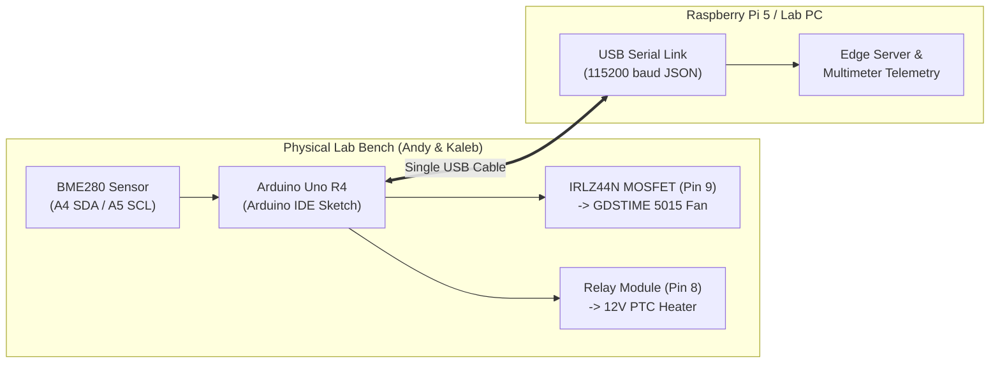

# ECE 441 Smart HVAC — Plug-and-Play Hardware & Software Lab Guide

**Authors:** Shashwat Choudhry, Andy Tran, Kaleb Cowgur, Haron Abuelhija  
**Reference:** Aligned 1:1 with the [10-26-29 Pinout Report (Hardware)](./10-26-29%20Pinout%20Report%20(Hardware))

---

## Part 1: How the Software Hooks Up to the Hardware (Plug-and-Play)

Our goal is **zero-friction plug-and-play**: software can be developed and simulated ahead of time in Wokwi, pulled in the lab (`git pull`), and opened directly in the **Arduino IDE** (`SmartHVAC_Arduino_Bench/SmartHVAC_Arduino_Bench.ino`) to upload to the **Arduino Uno R4** without changing any pin numbers or code.



* **Arduino Uno R4 (`SmartHVAC_Arduino_Bench/SmartHVAC_Arduino_Bench.ino`):** Reads the BME280 sensor, runs the built-in PID control loop, drives the MOSFET gate (`Pin 9`) with PWM to control fan speed, and switches the PTC heater relay (`Pin 8`).
* **USB Serial Connection (`115200` baud):** Instead of fighting campus Wi-Fi on the microcontroller, the Arduino sends clean JSON telemetry and live multimeter readings over its standard USB cable once per second, and listens for instant commands (`FAN 75`, `SET 24.0`, `AUTO`) in the **Arduino IDE Serial Monitor** (or from the Raspberry Pi 5).

---

### 1. Lab Pinout & Wiring Table (10-26-29 Bench Setup)

This matches the exact breadboard layout Andy and Kaleb built in the lab:

| Component | Lab Hardware Part | Arduino Pin | Wire / Ground Notes |
| :--- | :--- | :---: | :--- |
| **Fan Speed Switch** | **IRLZ44N MOSFET** (Gate - Left Pin `G`) | **`Pin 9`** | Hardware PWM output (`0–255` duty cycle). |
| **Blower Fan** | **GDSTIME 5015 Fan** | **`5V` & MOSFET `D`** | Fan `+` (Red) to `5V`; Fan `-` (Black) to MOSFET middle pin (**Drain `D`**). MOSFET right pin (**Source `S`**) to Common `GND`. |
| **PTC Heater Switch** | **Relay Module** (`IN` trigger) | **`Pin 8`** | Switches the 12V rail from the LM2596 / 12V supply to the PTC heating element. |
| **Temp / Humidity** | **Bosch BME280** (`SDA` & `SCL`) | **`A4` (SDA)**<br>**`A5` (SCL)** | Standard I2C pins (`0x76` / `0x77`). |
| **Sensor Power** | **Bosch BME280** (`VIN` & `GND`) | **`5V` & `GND`** | **IMPORTANT:** BME280 `GND` must go directly to its own dedicated **Arduino `GND` pin**—do not share the fan's ground return wire, or load noise will cause the sensor to brown out. |
| **Power Stage** | **12V 5A Supply + LM2596 Buck** | **Common `GND`** | Tie the negative rail of the 12V supply / buck converter to Arduino `GND` so the MOSFET and relay switch properly. |

---

## Part 2: Design Choices & Live Multimeter Readings

### 1. Simple Explanation of Design Choices

1. **Why the IRLZ44N MOSFET on `Pin 9` (Low-Side PWM Switching):**
   * The **IRLZ44N** is a *logic-level* MOSFET, meaning the Arduino's `5V` pin is strong enough to open it fully ($R_{DS(\text{on})} = 0.028\ \Omega$) without needing a separate gate driver.
   * When the Arduino runs `analogWrite(9, pwm)`, `Pin 9` pulses between `0V` and `5V`. Every pulse connects the fan's negative wire (`Drain`) to `GND` (`Source`), smoothly controlling fan speed from **0% to 100%**.
   * In our Wokwi simulation (`diagram.arduino_bench.json`), we built a custom **IRLZ44N MOSFET chip** with a live digital multimeter screen attached to it so you can watch the exact PWM % and electrical readings in real time.

2. **Automatic BME280 Reconnect (No More Hard Restarts):**
   * In the 10-26-29 report, Andy and Kaleb noted that if the BME280 jumper wire gets bumped or disconnected, the board needed a hard restart.
   * The sketch automatically checks if a reading returns `NaN` (disconnected) and performs a background `bme.begin()` soft-reset every 3 seconds so it recovers automatically without needing to press the reset button.

3. **How the Multimeter Readings & Circuit Resistance Work:**
   * Using the known electrical specs of our bench parts (`12V` main supply, `5V` rail, `45 mA` Arduino + sensor baseline draw, `14.29 Ω` fan winding, `0.028 Ω` MOSFET channel resistance, and `2.88 Ω` 12V PTC heater), the firmware calculates live **Voltage ($V$)**, **Current ($I$)**, **Power ($P = V \times I$)**, and **Total Equivalent Circuit Resistance ($R = V / I$)** every second:
     * **When Fan is OFF (`FAN 0`):** The MOSFET is an open switch ($\infty\ \Omega$). Only the Arduino + BME280 draw `45 mA`, so total resistance is high (`111.11 Ω` on the 5V rail, `563.20 Ω` on the 12V supply).
     * **As Fan Speed Ramps Up (`FAN 20` $\rightarrow$ `FAN 100`):** The MOSFET conducts for a larger fraction of each cycle. Fan current rises from `70 mA` to `349 mA`, lowering the effective resistance of the circuit down to `64.27 Ω` on the 12V bus.
     * **When the 12V PTC Heater Turns ON (`HEAT ON`):** The relay closes the `2.88 Ω` heating element across the 12V supply (`4.17 A`), bringing total power to `~52 W` and total circuit resistance to `2.76 Ω`.

---

### 2. Verified Electrical & Circuit Resistance Sweep ([test_bench_multimeter.py](./test_bench_multimeter.py))

Using our bench component ratings (**12V 5A Supply**, **LM2596 Buck Converter** $\eta=88\%$, **Arduino Uno R4 + BME280** $I_{\text{mcu}}=45\text{ mA}$, **GDSTIME 5015 Fan** $R_{\text{fan}}=14.29\ \Omega$, **IRLZ44N MOSFET** $R_{DS(\text{on})}=0.028\ \Omega$, and **12V 50W PTC Heater** $R_{\text{heater}}=2.88\ \Omega$):

| Command / State | Fan Speed (PWM) | Gate $V_{GS}$ | Fan $V_{\text{eff}}$ | Fan Current $I_{\text{fan}}$ | Heater Current $I_{\text{heat}}$ | Total Current $I_{\text{tot}}$ (12V Bus) | Total Power $P$ | Fan Branch $R_{\text{fan}}$ | 5V Rail $R_{5\text{V}}$ | **Total Circuit $R_{\text{total}}$ (12V)** |
| :--- | :--- | :---: | :---: | :---: | :---: | :---: | :---: | :---: | :---: | :---: |
| **`FAN 0`** *(MOSFET Cutoff)* | **0.0%** (`0`) | `0.00 V` | `0.00 V` | `0 mA` | `0.00 A` | `0.045 A` (`0.02 A`) | `0.22 W` | `OPEN (∞)` | `111.11 Ω` | **`563.20 Ω`** |
| **`AUTO`** *(Baseline Draft)* | **20.0%** (`51`) | `1.00 V` | `1.00 V` | `70 mA` | `0.00 A` | `0.115 A` (`0.05 A`) | `0.57 W` | `71.57 Ω` | `43.53 Ω` | **`220.65 Ω`** |
| **`FAN 35`** | **34.9%** (`89`) | `1.75 V` | `1.74 V` | `122 mA` | `0.00 A` | `0.167 A` (`0.08 A`) | `0.83 W` | `41.01 Ω` | `29.96 Ω` | **`151.84 Ω`** |
| **`FAN 50`** | **50.2%** (`128`) | `2.51 V` | `2.50 V` | `175 mA` | `0.00 A` | `0.220 A` (`0.10 A`) | `1.10 W` | `28.52 Ω` | `22.69 Ω` | **`115.02 Ω`** |
| **`FAN 75`** | **74.9%** (`191`) | `3.75 V` | `3.74 V` | `262 mA` | `0.00 A` | `0.307 A` (`0.14 A`) | `1.53 W` | `19.11 Ω` | `16.31 Ω` | **`82.65 Ω`** |
| **`FAN 100`** *(Full Saturation)* | **100.0%** (`255`) | `5.00 V` | `4.99 V` | `349 mA` | `0.00 A` | `0.394 A` (`0.19 A`) | `1.97 W` | `14.31 Ω` | `12.68 Ω` | **`64.27 Ω`** |
| **`HEAT ON` + `FAN 100`** | **100.0%** (`255`) | `5.00 V` | `4.99 V` | `349 mA` | `4.17 A` | `4.561 A` (`4.35 A`) | `51.97 W` | `14.31 Ω` | `12.68 Ω` | **`2.76 Ω`** |

---

## Part 3: Quick Lab Checklist for Andy & Kaleb (Arduino IDE)

1. **Pull Latest Code from GitHub:**
   ```bash
   git pull origin main
   ```
2. **Open in Arduino IDE:**
   * Open **`SmartHVAC_Arduino_Bench/SmartHVAC_Arduino_Bench.ino`** in the **Arduino IDE**.
   * Select Board: **Arduino Uno R4 WiFi** (or **Arduino Uno R4 Minima**) and select your USB port.
   * Click **Upload** (the PID algorithm is built directly into the `.ino` file, so only the `Adafruit BME280` library you already installed is needed).
3. **Open the Arduino IDE Serial Monitor (`115200` baud):**
   * Set the baud rate dropdown to **`115200`**.
   * You will see live 1-second JSON telemetry and the `[MULTIMETER]` bar showing Voltage ($V$), Current ($I$), Power ($W$), and Total Circuit Resistance ($\Omega$).
4. **Type Live Commands in the Arduino IDE Serial Monitor:**
   * **`FAN 75`** — Manually sets the blower fan to **75% speed** (`PWM = 191`) and prints an instant multimeter snapshot.
   * **`FAN 0`** — Turns the fan completely **OFF** (`PWM = 0`).
   * **`FAN 100`** — Runs the fan at **100% full speed** (`PWM = 255`).
   * **`PWM 128`** — Sets the raw 8-bit PWM value (`0–255`) on `Pin 9` directly.
   * **`HEAT ON`** / **`HEAT OFF`** — Manually switches the 12V PTC Heater relay (`Pin 8`) ON or OFF.
   * **`SET 24.5`** — Changes the target temperature setpoint to `24.5 °C`.
   * **`AUTO`** — Returns both the fan and heater to automatic closed-loop PID control based on the BME280 sensor.
