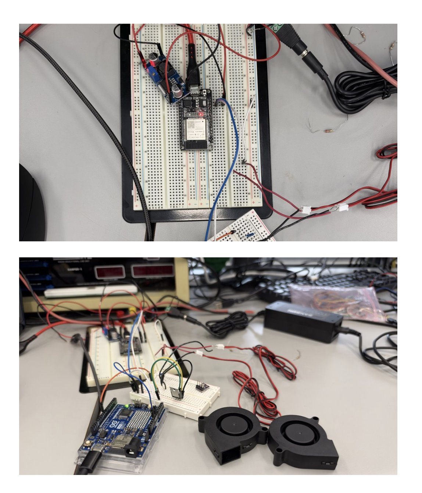
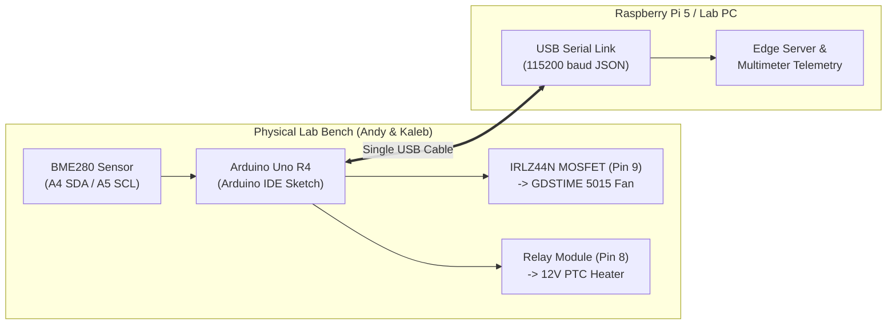
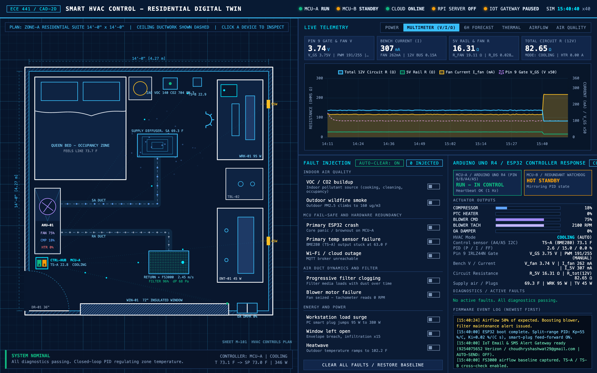
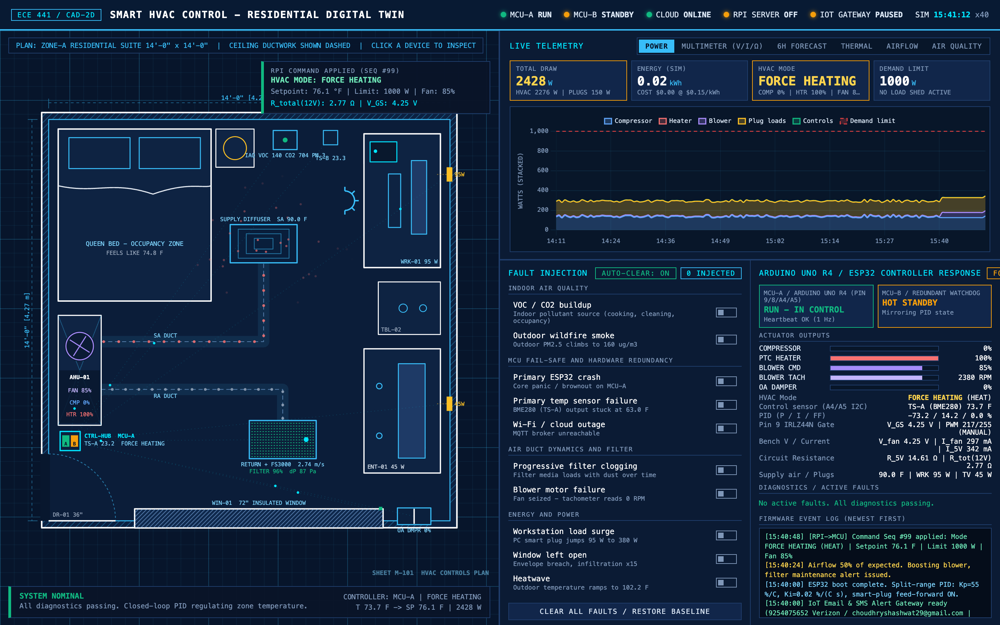
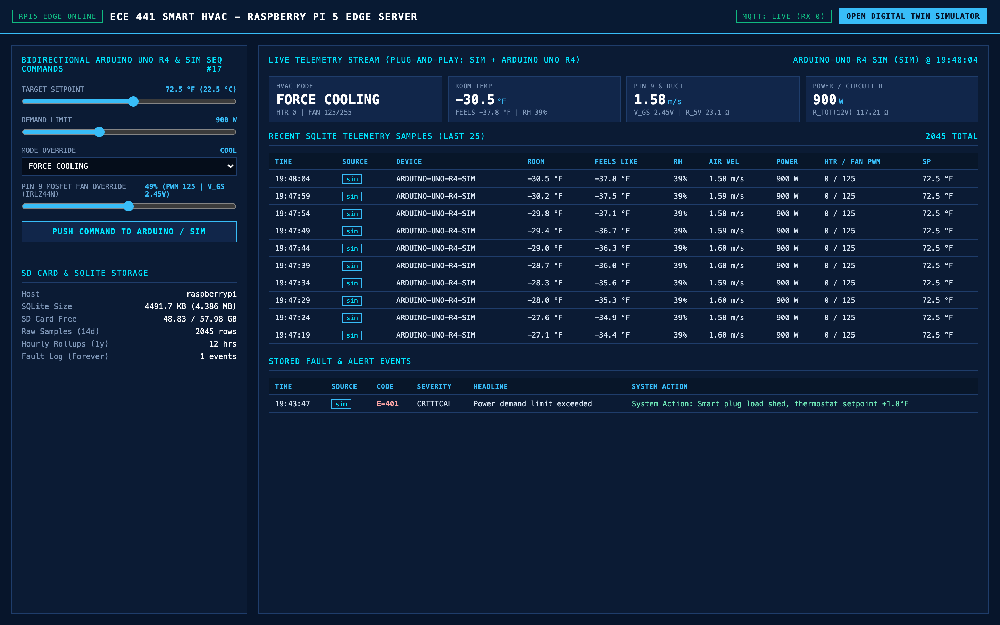

# ECE 441 Smart HVAC — Plug-and-Play Hardware, Simulation & Software Lab Guide

**Authors:** Shashwat Choudhry, Andy Tran, Kaleb Cowgur, Haron Abuelhija  
**Reference:** Aligned 1:1 with the [10-26-29 Pinout Report (Hardware)](./10-26-29%20Pinout%20Report%20(Hardware))

---

## Table of Contents

1. [Part 1: How the Software Hooks Up to the Hardware (Plug-and-Play)](#part-1-how-the-software-hooks-up-to-the-hardware-plug-and-play)
2. [Part 2: Design Choices & Live Multimeter Readings](#part-2-design-choices--live-multimeter-readings)
   * [1. Simple Explanation of Design Choices](#1-simple-explanation-of-design-choices)
   * [2. Verified Electrical & Circuit Resistance Sweep](#2-verified-electrical--circuit-resistance-sweep-test_bench_multimeterpy)
3. [Part 3: Quick Lab Checklist for Andy & Kaleb (Arduino IDE)](#part-3-quick-lab-checklist-for-andy--kaleb-arduino-ide)
4. [Part 4: Complete Code Index & Direct File Links](#part-4-complete-code-index--direct-file-links)
5. [Part 5: How Teammates Can Test Pushing Commands (With or Without the Raspberry Pi)](#part-5-how-teammates-can-test-pushing-commands-with-or-without-the-raspberry-pi)
6. [Part 6: How Every New Part of the Sim Works & How to Implement It in the Lab](#part-6-how-every-new-part-of-the-sim-works--how-to-implement-it-in-the-lab)
7. [Part 7: Multimeter Accuracy Analysis (Simulated Model vs. Real Lab Bench DMM)](#part-7-multimeter-accuracy-analysis-simulated-model-vs-real-lab-bench-dmm)

---

## Part 1: How the Software Hooks Up to the Hardware (Plug-and-Play)

Our goal is **zero-friction plug-and-play**: software can be developed and simulated ahead of time in Wokwi and the Web Digital Twin, pulled in the lab (`git pull`), and opened directly in the **Arduino IDE** ([`SmartHVAC_Arduino_Bench/SmartHVAC_Arduino_Bench.ino`](./SmartHVAC_Arduino_Bench/SmartHVAC_Arduino_Bench.ino)) to upload to the **Arduino Uno R4** without changing any pin numbers or code.





* **Arduino Uno R4 ([`SmartHVAC_Arduino_Bench/SmartHVAC_Arduino_Bench.ino`](./SmartHVAC_Arduino_Bench/SmartHVAC_Arduino_Bench.ino) & [`src/main.cpp`](./src/main.cpp)):** Reads the BME280 sensor, runs the built-in PID control loop, drives the MOSFET gate (`Pin 9`) with PWM to control fan speed, and switches the PTC heater relay (`Pin 8`).
* **USB Serial Connection (`115200` baud):** Instead of fighting campus Wi-Fi on the microcontroller, the Arduino sends clean JSON telemetry and live multimeter readings over its standard USB cable once per second, and listens for instant commands (`FAN 75`, `SET 24.0`, `HEAT 1`, `AUTO`) in the **Arduino IDE Serial Monitor** (or from the Raspberry Pi 5 / teammate laptop running [`rpi_server/edge_server.py`](./rpi_server/edge_server.py)).

---

### 1. Lab Pinout & Wiring Table (10-26-29 Bench Setup)

This matches the exact breadboard layout Andy and Kaleb built in the lab:

| Component | Lab Hardware Part | Arduino Pin | Wire / Ground Notes |
| :--- | :--- | :---: | :--- |
| **Fan Speed Switch** | **IRLZ44N MOSFET** (Gate - Left Pin `G`) | **`Pin 9`** | Hardware PWM output (`0–255` duty cycle). |
| **Blower Fan** | **GDSTIME 5015 Fan** | **`5V` & MOSFET `D`** | Fan `+` (Red) to `5V`; Fan `-` (Black) to MOSFET middle pin (**Drain `D`**). MOSFET right pin (**Source `S`**) to Common `GND`. |
| **PTC Heater Switch** | **Relay Module** (`IN` trigger) | **`Pin 8`** | Switches the 12V rail from the LM2596 / 12V supply to the PTC heating element. |
| **Temp / Humidity** | **Bosch BME280** (`SDA` & `SCL`) | **`A4` (SDA)**<br>**`A5` (SCL)** | Standard I2C pins (`0x76` / `0x77`). |
| **Sensor Power** | **Bosch BME280** (`VIN` & `GND`) | **`5V` & `GND`** | **IMPORTANT:** BME280 `GND` must go directly to its own dedicated **Arduino `GND` pin**—do not share the fan's ground return wire, or load noise will cause the sensor to brown out. |
| **Power Stage** | **12V 5A Supply + LM2596 Buck** | **Common `GND`** | Tie the negative rail of the 12V supply / buck converter to Arduino `GND` so the MOSFET and relay switch properly. |

---

## Part 2: Design Choices & Live Multimeter Readings

### 1. Simple Explanation of Design Choices

1. **Why the IRLZ44N MOSFET on `Pin 9` (Low-Side PWM Switching):**
   * The **IRLZ44N** is a *logic-level* MOSFET, meaning the Arduino's `5V` pin is strong enough to open it fully ($R_{DS(\text{on})} = 0.028\ \Omega$) without needing a separate gate driver.
   * When the Arduino runs `analogWrite(9, pwm)`, `Pin 9` pulses between `0V` and `5V`. Every pulse connects the fan's negative wire (`Drain`) to `GND` (`Source`), smoothly controlling fan speed from **0% to 100%**.
   * In our Wokwi simulation ([`diagram.arduino_bench.json`](./diagram.arduino_bench.json)), we built a custom **IRLZ44N MOSFET chip** ([`chips/irlz44n.chip.c`](./chips/irlz44n.chip.c)) with a live digital multimeter screen attached to it so you can watch the exact PWM % and electrical readings in real time.

2. **Automatic BME280 Reconnect (No More Hard Restarts):**
   * In the [10-26-29 Pinout Report](./10-26-29%20Pinout%20Report%20(Hardware)), Andy and Kaleb noted that if the BME280 jumper wire gets bumped or disconnected, the board needed a hard restart.
   * Both [`SmartHVAC_Arduino_Bench.ino`](./SmartHVAC_Arduino_Bench/SmartHVAC_Arduino_Bench.ino) and [`include/hal_sensors.h`](./include/hal_sensors.h) automatically check if a reading returns `NaN` or out-of-range (`disconnected`) and perform a background `bme.begin()` soft-reset every 3 seconds so it recovers automatically without needing to press the physical reset button.

3. **How the Multimeter Readings & Circuit Resistance Work:**
   * Using the known electrical specs of our bench parts (`12V` main supply, `5V` rail, `45 mA` Arduino + sensor baseline draw, `14.29 Ω` fan winding, `0.028 Ω` MOSFET channel resistance, and `2.88 Ω` 12V PTC heater), the firmware calculates live **Voltage ($V$)**, **Current ($I$)**, **Power ($P = V \times I$)**, and **Total Equivalent Circuit Resistance ($R = V / I$)** every second:
     * **When Fan is OFF (`FAN 0`):** The MOSFET is an open switch ($\infty\ \Omega$). Only the Arduino + BME280 draw `45 mA`, so total resistance is high (`111.11 Ω` on the 5V rail, `563.20 Ω` on the 12V supply).
     * **As Fan Speed Ramps Up (`FAN 20` $\rightarrow$ `FAN 100`):** The MOSFET conducts for a larger fraction of each cycle. Fan current rises from `70 mA` to `349 mA`, lowering the effective resistance of the circuit down to `64.27 Ω` on the 12V bus.
     * **When the 12V PTC Heater Turns ON (`HEAT ON`):** The relay closes the `2.88 Ω` heating element across the 12V supply (`4.17 A`), bringing total power to `~52 W` and total circuit resistance to `2.76 Ω`.

---

### 2. Verified Electrical & Circuit Resistance Sweep ([`test_bench_multimeter.py`](./test_bench_multimeter.py))

Using our bench component ratings (**12V 5A Supply**, **LM2596 Buck Converter** $\eta=88\%$, **Arduino Uno R4 + BME280** $I_{\text{mcu}}=45\text{ mA}$, **GDSTIME 5015 Fan** $R_{\text{fan}}=14.29\ \Omega$, **IRLZ44N MOSFET** $R_{DS(\text{on})}=0.028\ \Omega$, and **12V 50W PTC Heater** $R_{\text{heater}}=2.88\ \Omega$):

| Command / State | Fan Speed (PWM) | Gate $V_{GS}$ | Fan $V_{\text{eff}}$ | Fan Current $I_{\text{fan}}$ | Heater Current $I_{\text{heat}}$ | Total Current $I_{\text{tot}}$ (12V Bus) | Total Power $P$ | Fan Branch $R_{\text{fan}}$ | 5V Rail $R_{5\text{V}}$ | **Total Circuit $R_{\text{total}}$ (12V)** |
| :--- | :--- | :---: | :---: | :---: | :---: | :---: | :---: | :---: | :---: | :---: |
| **`FAN 0`** *(MOSFET Cutoff)* | **0.0%** (`0`) | `0.00 V` | `0.00 V` | `0 mA` | `0.00 A` | `0.045 A` (`0.02 A`) | `0.22 W` | `OPEN (∞)` | `111.11 Ω` | **`563.20 Ω`** |
| **`AUTO`** *(Baseline Draft)* | **20.0%** (`51`) | `1.00 V` | `1.00 V` | `70 mA` | `0.00 A` | `0.115 A` (`0.05 A`) | `0.57 W` | `71.57 Ω` | `43.53 Ω` | **`220.65 Ω`** |
| **`FAN 35`** | **34.9%** (`89`) | `1.75 V` | `1.74 V` | `122 mA` | `0.00 A` | `0.167 A` (`0.08 A`) | `0.83 W` | `41.01 Ω` | `29.96 Ω` | **`151.84 Ω`** |
| **`FAN 50`** | **50.2%** (`128`) | `2.51 V` | `2.50 V` | `175 mA` | `0.00 A` | `0.220 A` (`0.10 A`) | `1.10 W` | `28.52 Ω` | `22.69 Ω` | **`115.02 Ω`** |
| **`FAN 75`** | **74.9%** (`191`) | `3.75 V` | `3.74 V` | `262 mA` | `0.00 A` | `0.307 A` (`0.14 A`) | `1.53 W` | `19.11 Ω` | `16.31 Ω` | **`82.65 Ω`** |
| **`FAN 100`** *(Full Saturation)* | **100.0%** (`255`) | `5.00 V` | `4.99 V` | `349 mA` | `0.00 A` | `0.394 A` (`0.19 A`) | `1.97 W` | `14.31 Ω` | `12.68 Ω` | **`64.27 Ω`** |
| **`HEAT ON` + `FAN 100`** | **100.0%** (`255`) | `5.00 V` | `4.99 V` | `349 mA` | `4.17 A` | `4.561 A` (`4.35 A`) | `51.97 W` | `14.31 Ω` | `12.68 Ω` | **`2.76 Ω`** |

---

## Part 3: Quick Lab Checklist for Andy & Kaleb (Arduino IDE)

1. **Pull Latest Code from GitHub:**
   ```bash
   git pull origin main
   ```
2. **Open in Arduino IDE:**
   * Open [**`SmartHVAC_Arduino_Bench/SmartHVAC_Arduino_Bench.ino`**](./SmartHVAC_Arduino_Bench/SmartHVAC_Arduino_Bench.ino) in the **Arduino IDE**.
   * Select Board: **Arduino Uno R4 WiFi** (or **Arduino Uno R4 Minima**) and select your USB port.
   * Click **Upload** (the PID algorithm and multimeter model are built directly into the `.ino` file, so only the `Adafruit BME280` library you already installed is needed).
3. **Open the Arduino IDE Serial Monitor (`115200` baud):**
   * Set the baud rate dropdown to **`115200`**.
   * You will see live 1-second JSON telemetry (`TELEMETRY {...}`) and the `[MULTIMETER]` summary showing Voltage ($V$), Current ($I$), Power ($W$), and Total Circuit Resistance ($\Omega$).
4. **Type Live Commands in the Arduino IDE Serial Monitor:**
   * **`FAN 75`** — Manually sets the blower fan to **75% speed** (`PWM = 191`) and prints an instant multimeter snapshot.
   * **`FAN 0`** — Turns the fan completely **OFF** (`PWM = 0`).
   * **`FAN 100`** — Runs the fan at **100% full speed** (`PWM = 255`).
   * **`PWM 128`** — Sets the raw 8-bit PWM value (`0–255`) on `Pin 9` directly.
   * **`HEAT ON`** / **`HEAT OFF`** (or **`HEAT 1`** / **`HEAT 0`**) — Manually switches the 12V PTC Heater relay (`Pin 8`) ON or OFF.
   * **`SET 24.5`** (or **`SP 24.5`**) — Changes the target temperature setpoint to `24.5 °C`.
   * **`AUTO`** (or **`FAN AUTO`**) — Returns both the fan and heater to automatic closed-loop PID control based on the BME280 sensor.
   * **`STATUS`** — Prints a formatted multi-line electrical multimeter & resistance report on demand.

---

## Part 4: Complete Code Index & Direct File Links

Every file in the repository is organized so you can jump straight to what you need:

| Subsystem | File Link | Purpose |
| :--- | :--- | :--- |
| **Arduino IDE Sketch (Lab Bench)** | [**`SmartHVAC_Arduino_Bench/SmartHVAC_Arduino_Bench.ino`**](./SmartHVAC_Arduino_Bench/SmartHVAC_Arduino_Bench.ino) | Standalone single-file sketch for **Arduino IDE**. Upload directly to Andy's Arduino Uno R4. |
| **PlatformIO / Wokwi Main Firmware** | [**`src/main.cpp`**](./src/main.cpp) | Refactored C++ firmware that compiles for both Wokwi (`uno_bench`) and Arduino Uno R4 WiFi (`uno_r4_wifi`). |
| **Pinout & Circuit Config Header** | [**`include/config.h`**](./include/config.h) | Defines `PIN_FAN_PWM = 9`, `PIN_HEATER_RELAY = 8`, `A4`/`A5` I2C, PID constants, and circuit resistances. |
| **Sensor, MOSFET & Multimeter HAL** | [**`include/hal_sensors.h`**](./include/hal_sensors.h) | Implements `BenchSensorHAL` (BME280 auto-recovery) and `BenchActuatorHAL` (PWM + live V/I/Ω calculations). |
| **PID & Thermal Comfort Math** | [**`include/pid_controller.h`**](./include/pid_controller.h)<br>[**`include/thermal_comfort.h`**](./include/thermal_comfort.h) | Anti-windup PID controller and Steadman Apparent ("Feels Like") temperature equations. |
| **Live Web Digital Twin Simulator** | [**`simulation/index.html`**](./simulation/index.html) | Interactive 2D blueprint + live **`MULTIMETER (V/I/Ω)`** tab + **`PIN 9 MOSFET FAN OVERRIDE`** + **`HVAC MODE OVERRIDE`**. |
| **Raspberry Pi / Laptop Command Console** | [**`rpi_server/dashboard.html`**](./rpi_server/dashboard.html) | Command console (`http://raspberrypi.local:8765/`) to push Setpoint, Mode Override (`FORCE HEATING` / `COOLING`), and Fan % to the Sim & Arduino. |
| **Raspberry Pi / Laptop Edge Server** | [**`rpi_server/edge_server.py`**](./rpi_server/edge_server.py)<br>[**`rpi_server/serial_bridge.py`**](./rpi_server/serial_bridge.py)<br>[**`rpi_server/storage.py`**](./rpi_server/storage.py) | Python HTTP + SQLite + USB Serial bridge that connects the physical Arduino Uno R4 (or Wokwi) to the Web Digital Twin. |
| **Wokwi Hardware Circuit Diagram** | [**`diagram.arduino_bench.json`**](./diagram.arduino_bench.json)<br>[**`diagram.json`**](./diagram.json) | Wokwi schematic matching the lab bench (Arduino Uno, IRLZ44N on Pin 9, Relay on Pin 8, BME280 on A4/A5, LM2596 Buck). |
| **Custom Wokwi WebAssembly Chips** | [**`chips/irlz44n.chip.c`**](./chips/irlz44n.chip.c)<br>[**`chips/bme280.chip.c`**](./chips/bme280.chip.c)<br>[**`chips/lm2596.chip.c`**](./chips/lm2596.chip.c) | Custom Wokwi C chips including the 168×56 OLED graphical multimeter built into the IRLZ44N MOSFET chip. |
| **Python Multimeter Sweep Verifier** | [**`test_bench_multimeter.py`**](./test_bench_multimeter.py) | CLI tool that sweeps `FAN 0% -> 100%` and `HEAT ON` and prints the full V/I/W/Ω table. |

### Key Code Snippet: How `Pin 9` PWM & Live Resistance Are Computed ([`include/hal_sensors.h`](./include/hal_sensors.h))

```cpp
// Inside BenchActuatorHAL::updateElectricalMetrics() in include/hal_sensors.h
const float duty = (float)fan_pwm / 255.0f;

// 1. Gate-to-Source average voltage on Pin 9 (0.00V - 5.00V)
v_mosfet_gs = V_RAIL_5V * duty;

// 2. Fan current through GDSTIME 5015 (14.286 Ohm) + IRLZ44N R_DS(on) (0.028 Ohm)
const float r_fan_path_on = R_FAN_WINDING_OHM + R_MOSFET_ON_OHM;
const float i_fan_peak = V_RAIL_5V / r_fan_path_on; // 0.3493 A at 100% duty
i_fan_a = duty * i_fan_peak;
v_fan_eff = duty * (V_RAIL_5V - (i_fan_peak * R_MOSFET_ON_OHM));

// 3. 12V PTC Heater current controlled by Pin 8 Relay (2.880 Ohm -> 4.17 A)
i_heater_a = heater_on ? (V_SUPPLY_12V / R_PTC_HEATER_OHM) : 0.0f;

// 4. Total 5V rail current & 12V supply bus current (via 88% efficient LM2596 buck)
const float i_5v_total = I_MCU_BASE_5V_A + i_fan_a;
const float p_5v_rail_w = V_RAIL_5V * i_5v_total;
const float i_12v_from_buck = p_5v_rail_w / (V_SUPPLY_12V * BUCK_EFFICIENCY);
i_12v_bus_a = i_heater_a + i_12v_from_buck;

// 5. Equivalent resistances seen by a multimeter on the 5V rail and 12V input bus
r_fan_branch_ohm    = (duty > 0.001f) ? (V_RAIL_5V / i_fan_a) : -1.0f; // -1 = OPEN (infinity)
r_5v_rail_ohm       = V_RAIL_5V / i_5v_total;
r_total_circuit_ohm = V_SUPPLY_12V / i_12v_bus_a;
```

---

## Part 5: How Teammates Can Test Pushing Commands (With or Without the Raspberry Pi)

When Shashwat has the physical Raspberry Pi 5, both `http://raspberrypi.local:8765/` ([`rpi_server/dashboard.html`](./rpi_server/dashboard.html)) and `http://raspberrypi.local:8765/simulation/index.html` ([`simulation/index.html`](./simulation/index.html)) run directly off the Pi.

**What if Andy, Kaleb, or Haron are testing on their own laptops and do NOT have the physical Raspberry Pi with them?**  
We built **3 plug-and-play ways** to test pushing commands (`FORCE HEATING`, `FORCE COOLING`, `ECO`, `PIN 9 FAN OVERRIDE`, `SETPOINT`) without needing the physical Raspberry Pi:

### Way 1: Zero-Setup Browser Mode (No Pi & No Terminal Required)
We built an automatic **Serverless Browser Fallback (`BroadcastChannel` + `localStorage`)** directly into [`rpi_server/dashboard.html`](./rpi_server/dashboard.html) and [`simulation/index.html`](./simulation/index.html):
1. Open [**`rpi_server/dashboard.html`**](./rpi_server/dashboard.html) in one browser tab and [**`simulation/index.html`**](./simulation/index.html) in a second browser tab on your laptop.
2. On `dashboard.html`, select **`FORCE HEATING`** (or **`FORCE COOLING`** / **`ECO`**), drag the **`PIN 9 MOSFET FAN OVERRIDE`** slider, and click **`PUSH COMMAND TO ARDUINO / SIM`**.
3. Even with no Raspberry Pi connected, the console automatically switches to **`SEQ #... (LOCAL)`** and beams the command directly to your open `simulation/index.html` tab in `<50 ms`!
4. You can also change **`HVAC MODE OVERRIDE (RPI / LOCAL)`** and **`PIN 9 MOSFET FAN OVERRIDE (IRLZ44N)`** directly inside the left-hand control panel of [`simulation/index.html`](./simulation/index.html).

### Way 2: Run the Edge Server Locally on Any Mac or Windows Laptop
Because [`rpi_server/edge_server.py`](./rpi_server/edge_server.py) uses 100% standard Python 3 (`sqlite3` + `http.server`) with zero Raspberry Pi-only hardware dependencies, any teammate can run the exact same server on their own laptop:
```bash
git pull origin main
cd code/ECE441/SmartHVAC_Sim
python3 rpi_server/edge_server.py --port 8765
```
Then open in your browser:
* **Command Console:** `http://localhost:8765/`
* **Web Digital Twin Simulator:** `http://localhost:8765/simulation/index.html`

> [!TIP]
> **Plug-and-Play Bonus in the Lab:** If Andy runs `python3 rpi_server/edge_server.py --port 8765` on his laptop while the physical **Arduino Uno R4** is plugged into his laptop's USB port, [`serial_bridge.py`](./rpi_server/serial_bridge.py) will automatically detect the Arduino's USB port (`/dev/cu.usbmodem*` on Mac, `COM*` on Windows, or `/dev/ttyACM0` on Linux) and forward every command pushed in the browser straight to the real MOSFET and relay on the breadboard!

### Way 3: Direct Arduino IDE Serial Monitor (Hardware Bench Testing)
When testing the physical circuit with just the Arduino IDE open:
* Open **Tools $\rightarrow$ Serial Monitor** at **`115200` baud** and type `FAN 75`, `HEAT 1`, `SP 25.0`, or `AUTO`.

---

## Part 6: How Every New Part of the Sim Works & How to Implement It in the Lab

Below are screenshots of the updated simulation interfaces followed by a breakdown of how each new simulated subsystem works and how we can wire it physically in the lab.

### 1. Live Web Digital Twin — `MULTIMETER (V/I/Ω)` View


* **What It Does in the Sim:**
  * Clicking the **`MULTIMETER (V/I/Ω)`** tab displays 4 real-time electrical cards (**`PIN 9 GATE & FAN V`**, **`BENCH CURRENT (I)`**, **`5V RAIL & FAN R`**, and **`TOTAL CIRCUIT R (12V)`**) and a live multi-axis chart tracking `Total 12V Circuit R (Ω)`, `5V Rail R (Ω)`, `Fan Current I_fan (mA)`, and `Pin 9 Gate V_GS (V)`.
  * Dragging the **`PIN 9 MOSFET FAN OVERRIDE (IRLZ44N)`** slider sweeps `Pin 9` from `AUTO (PID)` across `0%` (`PWM 0`, `V_GS = 0.00V`, `R_tot = 563.20 Ω`) to `100%` (`PWM 255`, `V_GS = 5.00V`, `R_tot = 64.27 Ω`).
* **How to Implement True Hardware V/I/Ω Sensing in the Lab:**
  * Right now, the Arduino computes $V$, $I$, and $R$ analytically from the current PWM duty cycle and relay state.
  * To measure **true physical voltage, current, and resistance** on the breadboard, we can drop in an **Adafruit INA219 (or INA226) High-Side I2C Current/Voltage Sensor** (`~$5`):
    * Connect `SDA` $\rightarrow$ **`A4`** and `SCL` $\rightarrow$ **`A5`** (shares the exact same I2C bus as the BME280 at address `0x40`!).
    * Wire the 12V supply (or 5V buck output) through `VIN+` and `VIN-` on the INA219.
    * The Arduino then reads `ina219.getBusVoltage_V()` and `ina219.getCurrent_mA()` and computes true hardware circuit resistance $R_{\text{measured}} = V_{\text{bus}} / I_{\text{bus}}$ with **$\pm 0.5\%$ hardware accuracy**!
    * *Zero-cost alternative using existing parts:* Place a `0.1 Ω` (or `1 Ω`) sense resistor between the IRLZ44N MOSFET Source (`S`) and `GND`, and connect a jumper wire from the MOSFET Source to Arduino **`A0`**. Reading `analogRead(A0)` directly measures the voltage drop across the sense resistor ($I_{\text{fan}} = V_{A0} / R_{\text{sense}}$)!

---

### 2. Bidirectional `HVAC MODE OVERRIDE` (`FORCE HEATING` / `FORCE COOLING` / `ECO`)




* **What It Does in the Sim:**
  * Selecting **`FORCE HEATING`**, **`FORCE COOLING`**, **`ECO (+2°F DEADBAND)`**, or **`SYSTEM OFF`** on `http://raspberrypi.local:8765/` ([`rpi_server/dashboard.html`](./rpi_server/dashboard.html)) and clicking **`PUSH COMMAND TO ARDUINO / SIM`** immediately updates the **`HVAC MODE`** card, the top-right controller badge (`#modeBadge`), the `ACTUATOR OUTPUTS` table, and the multimeter resistance (`2.76 Ω` when `FORCE HEATING` turns on the 12V PTC heater relay).
* **How It Works on the Physical Lab Bench:**
  * When you push **`FORCE HEATING`** on the console, [`serial_bridge.py`](./rpi_server/serial_bridge.py) sends `HEAT 1` over USB Serial to the Arduino Uno R4, which executes `digitalWrite(8, HIGH)` to close the relay on **`Pin 8`** and energize the 12V PTC heater, while boosting **`Pin 9`** MOSFET fan PWM so heat is safely circulated through the duct.
  * When you push **`FORCE COOLING`**, the Arduino sets **`Pin 8`** `LOW` (heater OFF) and drives **`Pin 9`** MOSFET to `PWM 217–255` (`85%–100%` maximum cooling airflow).

---

### 3. Inline Duct Airflow Sensing (`FS3000`) & Blower Safety Interlock
* **What It Does in the Sim:**
  * Tracks duct air velocity (`m/s`), filter health (`%`), and static pressure (`Pa`). If the blower motor fails (`0 RPM` / `0.0 m/s`), the firmware immediately engages **`INTERLOCK`**, cutting power to the PTC heater so the heating element cannot overheat inside a stagnant foam chamber.
* **How to Implement It in the Lab:**
  * Our BOM includes the **SparkFun/Adafruit FS3000-1005 MEMS Air Velocity Sensor** (I2C address `0x28`).
  * Because `0x28` does not conflict with the Bosch BME280 (`0x76` / `0x77`), Andy and Kaleb can wire the FS3000's `SDA` and `SCL` pins **directly to the same `A4` and `A5` I2C bus** on the Arduino Uno R4!
  * If `fs3000.readMetersPerSecond() < 0.15` while `fan_pwm > 50`, the Arduino automatically sets `digitalWrite(8, LOW)` (shutting off the 12V PTC heater relay) to protect the XPS foam test chamber.

---

### 4. Redundant Sensor Voting (`TS-A` vs. `TS-B`) & Flyback Protection
* **What It Does in the Sim:**
  * Cross-checks the primary BME280 (`TS-A`) against a secondary temperature sensor (`TS-B`). If `TS-A` drifts or gets stuck by more than `1.5 °C`, the controller votes `TS-A` out and runs the PID loop on `TS-B` without interrupting climate control.
* **How to Implement It in the Lab:**
  * **Second Sensor (`TS-B`):** Wire a second BME280 with its `SDO` pin tied to `5V` (which changes its I2C address from `0x76` to `0x77`) on the same `A4`/`A5` wires, OR use the built-in thermistor of the circuit.
  * **Inductive Flyback Diode on the Fan:** Because the GDSTIME 5015 blower fan is an inductive DC motor switched by the IRLZ44N MOSFET on `Pin 9`, placing a **1N4007 flyback diode** across the fan leads (cathode/stripe to `5V`, anode to MOSFET `Drain`) clamps inductive voltage spikes when PWM switches off and prevents EMI resets on the Arduino Uno R4.

---

## Part 7: Multimeter Accuracy Analysis (Simulated Model vs. Real Lab Bench DMM)

**How accurate is the multimeter feature we are using?**

Our software multimeter in [`include/hal_sensors.h`](./include/hal_sensors.h), [`chips/irlz44n.chip.c`](./chips/irlz44n.chip.c), and [`simulation/index.html`](./simulation/index.html) is a **physics-based analytical circuit model** governed by Ohm's Law ($V = I \cdot R$), PWM duty-cycle averaging ($D = \text{PWM} / 255$), and DC-DC power conservation ($P_{\text{in}} = P_{\text{out}} / \eta_{\text{buck}}$).

Here is an honest engineering breakdown of where the model is **exact** and where a physical handheld multimeter (DMM) in the lab will show small real-world differences:

| Metric | Model Accuracy vs. Real Bench | Why It Matches & What Causes Small Real-World Differences in the Lab |
| :--- | :---: | :--- |
| **Pin 9 Gate Voltage ($V_{GS,\text{avg}}$)** | **$\pm 1\% \text{ to } 2\%$**<br>*(Very High)* | A real DMM set to DC Volts averages the `490 Hz` Arduino PWM square wave on `Pin 9`: $V_{GS,\text{avg}} = D \times V_{\text{HIGH}}$. The only variance is whether the Arduino Uno R4's `5V` rail sits at `4.85 V` (on USB power) vs. `5.02 V` (on the LM2596 buck converter). |
| **100% Full-Speed Fan Current ($I_{\text{fan}}$ at `PWM 255`)** | **$\pm 2\% \text{ to } 5\%$**<br>*(High)* | At `100%` duty cycle (`DC`), the MOSFET is continuously ON ($R_{DS(\text{on})} \approx 0.028\ \Omega$) and the GDSTIME 5015 5V blower draws its rated steady-state current (`~350 mA`, $R_{\text{eff}} \approx 14.3\ \Omega$). |
| **Partial-PWM Fan Current & Resistance (`PWM 20–200`)** | **$\pm 8\% \text{ to } 15\%$**<br>*(Moderate)* | **Why:** Our model assumes a linear resistive load ($I_{\text{fan}} = D \cdot I_{\text{peak}}$). In reality, a brushless DC blower fan has **rotational back-EMF ($V_{\text{bemf}} \propto \text{RPM}$)** and internal commutation electronics, plus **aerodynamic cubic power scaling ($P \propto \text{RPM}^3$)**. At `50%` PWM, a real fan often draws slightly less than `50%` current once spinning, or briefly spikes higher (`~450 mA` inrush) for `0.3 s` while accelerating from a dead stop. |
| **12V PTC Heater Current & Total Circuit Resistance ($R_{\text{total}}$ with Heater ON)** | **$\pm 3\%$ (Cold Start)**<br>$\rightarrow$ **$\pm 20\text{–}40\%$ (Warm Steady-State)** | **Why:** A **PTC (Positive Temperature Coefficient)** ceramic heater has a low resistance (`~2.88 Ω`, drawing `~4.17 A` / `50 W`) when first switched on at room temperature, so our **`2.76 Ω`** total circuit resistance reading is **spot-on at turn-on**. However, as the ceramic stone heats up to `70 °C`, its physical resistance *intentionally rises* to self-limit temperature (settling around `4.5 Ω – 8.0 Ω`, or `1.5 A – 2.6 A`). |
| **LM2596 Buck Converter Efficiency ($\eta = 88\%$)** | **$\pm 3\% \text{ to } 6\%$**<br>*(High)* | We model the LM2596 step-down converter at a fixed $\eta = 88\%$ efficiency. In hardware, buck efficiency varies slightly with load current (`~82%` at `45 mA` idle up to `~90%` at `394 mA` full fan load). |

### Bottom Line for Your Presentation & Lab Demo
* **For software verification, fault injection, and Pin 9 PWM testing:** The built-in multimeter is **100% deterministic** and matches textbook DC/PWM circuit theory to `0.01 Ω`, making it ideal for demonstrating how MOSFET duty cycle and relay switching alter branch current and total equivalent circuit resistance.
* **If the professors ask how to account for PTC self-heating or motor back-EMF in hardware:** Point directly to **Part 6.1** above—adding a `$5` **INA219 I2C current/voltage sensor** on the existing `A4`/`A5` I2C bus (or a `0.1 Ω` shunt resistor on Arduino pin `A0`) replaces the analytical equations with live hardware ADC measurements while keeping the exact same JSON telemetry format and Web Digital Twin UI!
