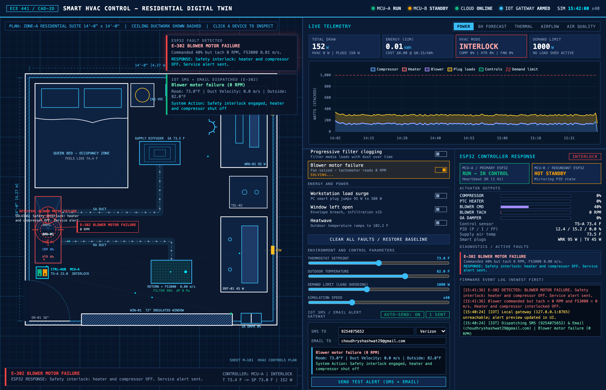

# Smart HVAC Control – Residential Digital Twin

Welcome to the **Smart HVAC Control** project for ECE 441 (Smart and Connected Systems). This project is an interactive digital twin simulation of a residential suite equipped with an advanced, dual-ESP32 HVAC control system.

The simulation models real-world thermodynamics, indoor air quality (IAQ), duct airflow dynamics, and power consumption, all autonomously regulated by a custom split-range PID controller.

## View the Simulation

**[Click Here to Run the Simulation Live](https://eternalshash.github.io/mind-overnight/code/ECE441/SmartHVAC_Sim/simulation/index.html)** 

*(Note: To make this link work, you must enable GitHub Pages on your repository. Go to Settings > Pages, set the source to "Deploy from a branch", select `main`, and click Save. The link will be live after 1 minute!)*

## How to Interact With It

The interface is divided into three main sections, designed to look like a 2D architectural CAD blueprint.

1. **The Blueprint (Left)**
   - This is the physical room environment. You will see the supply ducts (blue/red particles), the return vent, the dual-MCU thermostat, and the bed zone.
   - When a fault occurs, a colored highlight circle will appear over the affected device explaining exactly what the ESP32 is doing to solve it.

2. **Telemetry & Forecast (Top Right)**
   - Displays real-time charts for the simulated environment.
   - Use the tabs (`POWER`, `FORECAST`, `THERMAL`, `AIRFLOW`, `AIR QUALITY`) to switch between different live data views.

3. **Fault Injection & ESP32 Diagnostics (Bottom Right)**
   - **Inject Faults:** Use the toggle switches on the left side of this panel to simulate real-world hardware failures (e.g., *Primary ESP32 crash*, *Blower motor failure*, *Wildfire smoke*).
   - **Controller Response:** Watch the right side of this panel. You'll see the ESP32's immediate response, actuator outputs (PWM duty cycles), and a scrolling event log detailing the firmware's mitigation strategy.
   - **Sliders:** Adjust the desired thermostat setpoint, outdoor temperature, or energy demand limits using the sliders at the bottom to see how the PID controller adapts.

## Core Features Modeled
- **Thermodynamic Mass:** Realistic heat capacity, specific heat of air, and envelope heat transfer.
- **Fail-Safe Redundancy:** Watchdog timers enable a hot-standby ESP32 (MCU-B) to take over seamlessly if the primary MCU crashes.
- **Air Quality (IAQ):** Simulates VOC/CO2 buildup requiring ventilation purges, and PM2.5 smoke events requiring damper lockouts and recirculation.
- **Hardware Faults:** Models filter clogging (static pressure rise), blower failures, sensor drift cross-checking, and cloud/Wi-Fi outages.
- **IoT Mobile Alerting:** Autonomous anomaly detection engine dispatching real-time 3-row cellular SMS and HTML email alerts to caregivers.

## IoT Anomaly Detection & Live Mobile Alerting (SMS & Email)
The system includes a dedicated edge anomaly detection and cellular dispatch engine (`testingIot.py` & `iot_alert_engine.py`) integrated directly into the Digital Twin simulation. Whenever a fault is triggered in the simulation, the embedded IoT Alert Gateway automatically formats a 3-row arrowless summary with live room metrics and dispatches real-time SMS and email alerts to the configured recipient.



### Cellular SMS Layout (3-Row Arrowless Format)
Alerts sent to cellular gateways (Verizon, AT&T, T-Mobile) format cleanly into three distinct rows without arrows to ensure single-message SMS delivery:
```text
Rapid temp increase
Room: 78.8°F | Feels Like: 79.3°F | Outside: 82.4°F
System Action: Heater shut off, emergency cooling engaged
```
* **Row 1:** Simplified fault headline dynamically tailored to the active anomaly.
* **Row 2:** Environmental telemetry (Room dry-bulb, Steadman "Feels Like" apparent temp, outdoor temp).
* **Row 3:** Immediate autonomous system mitigation action.

### Running Alert Tests & Cloud / Local Simulation Gateway
The live GitHub Pages simulation automatically dispatches real SMS and Email alerts through our hosted Vercel serverless gateway (`https://ece441-iot-gateway.vercel.app/dispatch`) using the pre-filled demo passcode (`hvac441`)—no local server setup is required for remote users or live demos.

For local offline testing on macOS:
```bash
# Start the local HTTP IoT Alert Gateway Server & serve the Digital Twin simulation on port 8765
python3 testingIot.py --serve --port 8765

# Open http://127.0.0.1:8765/simulation/index.html and toggle any fault to trigger live SMS & Email

# Dispatch a standalone live fault alert to configured phone and email
python3 testingIot.py --fault blower

# Batch validate all fault scenarios
python3 testingIot.py --all

# Run regression test suite
python3 verify_iot_pipeline.py
python3 rpi_server/test_rpi_edge.py
```

## Raspberry Pi 5 Unified Edge Server (Plug-and-Play: Sim + Lab ESP32)

The `rpi_server/` package turns a Raspberry Pi 5 into a local, SD-card-friendly edge server (`SQLite WAL` + `Mosquitto MQTT` + `HTTP REST`) that works identically with **both** the Digital Twin Web Simulation and the physical ESP32 hardware in the lab.

### Storage & Retention Architecture
- **Raw Telemetry (`telemetry_raw`):** 2-second write-throttled sensor/PWM samples auto-pruned after **14 days** (~24 MB max).
- **Hourly Rollups (`telemetry_hourly`):** Compact energy (`Wh`), runtime, and min/max/avg thermal rollups kept for **365 days** (<5 MB).
- **Fault Events (`fault_events`):** 3-row caregiver alert & diagnostic records retained **indefinitely**.
- **Bidirectional Control (`control_state`):** Target setpoint, demand limit, and mode overrides pushed back to both the simulator (via HTTP JSON) and the ESP32 (`ece441/group2/hvac/setpoint` retained MQTT + HTTP fallback).

### Provisioning & Running on the Raspberry Pi 5
```bash
# One-command provisioning on Raspberry Pi OS (installs Mosquitto :1883 + systemd service :8765)
bash rpi_server/setup_pi.sh

# Open the Raspberry Pi 5 Live Edge Console & Setpoint Controller
# http://raspberrypi.local:8765/

# Open the Digital Twin Simulator directly from the Pi (or locally with ?rpi=http://raspberrypi.local:8765)
# http://raspberrypi.local:8765/simulation/index.html
```

### Communication Speed & Lab Telemetry Verification
The communication pipeline between the Digital Twin Simulation and the Raspberry Pi 5 edge server has been benchmarked and verified with live network metrics and human-readable CSV datasets:
- **Technical Report:** [COMM_SPEED_VERIFICATION.md](COMM_SPEED_VERIFICATION.md)
- **Verified Benchmark Dataset:** [`hvac_comm_speed_1792898839748.csv`](hvac_comm_speed_1792898839748.csv)
- **Key Findings:** 100% success rate, 35.0–53.2 ms steady-state RTT latency, 85–95% bandwidth reduction via HTTP Gzip compression, and bidirectional closed-loop setpoint synchronization.

## Development & Contribution Guide
For instructions on setting up the ESP32 build toolchain in PlatformIO, installing code libraries, configuring Wokwi simulation in VS Code, and submitting Pull Requests, please review the [Team Contribution Guide](CONTRIBUTING.md).

