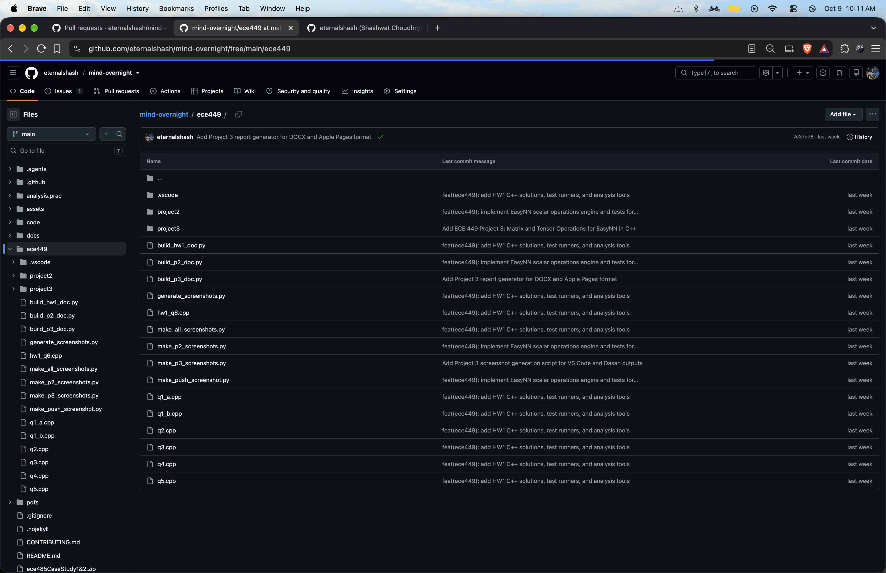

# Smart HVAC Control - Engineering Technical Log

This technical log is automatically maintained to record engineering implementations, hardware pinout configurations, closed-loop control algorithms, physical thermodynamic simulations, and cloud telemetry updates across all team members.

---

### [2026-11-19] Shashwat Choudhry
* **Commit:** `59d2268`
* **Technical Summary:** Add real-time incremental Nest wheel fan/heater PWM control and integrated HiveMQ WebSocket console. Modified files in the Smart HVAC subsystem.

---

### [2026-11-19] Shashwat Choudhry
* **Commit:** `122ca0e`
* **Technical Summary:** Implement end-to-end wireless HiveMQ remote execution, closed-loop Nest dial sync, and V6.0 fault telemetry. Modified files in the Smart HVAC subsystem.

---

### [2026-11-19] Shashwat Choudhry
* **Commit:** `e6c9d77`
* **Technical Summary:** Fix(ece441): fix UNO R4 HiveMQ connection using TCP 1883, unique MAC ClientID, and <256B MQTT payload. Modified files in the Smart HVAC subsystem.

---

### [2026-11-19] Shashwat Choudhry
* **Commit:** `6e49aae`
* **Technical Summary:** Feat(ece441): add standalone SmartHVAC_Wireless_AllInOne sketch with embedded secrets, fan/heater control, HiveMQ & sim sync. Modified files in the Smart HVAC subsystem.

---

### [2026-11-19] Shashwat Choudhry
* **Commit:** `11c3638`
* **Technical Summary:** Feat(ece441): add standalone Arduino UNO R4 WiFi connection tester sketch. Modified files in the Smart HVAC subsystem.

---

### [2026-11-19] Shashwat Choudhry
* **Commit:** `b8b0293`
* **Technical Summary:** Feat(ece441): add wireless WiFiS3 & cloud MQTT telemetry to Smart HVAC Arduino bench. Modified files in the Smart HVAC subsystem.

---

### [2026-11-15] Shashwat Choudhry
* **Commit:** `99283f9`
* **Technical Summary:** Rust and Uni work. Modified files in the Smart HVAC subsystem.

---

### [2026-11-15] Shashwat Choudhry
* **Commit:** `7b68f8e`
* **Technical Summary:** Test(v5): verify end-to-end HVAC-proto.ino V5 serial parsing, Pin 10 relay, and BME688 parity. Modified files in the Smart HVAC subsystem.

---

### [2026-11-15] Shashwat Choudhry
* **Commit:** `232e416`
* **Technical Summary:** Feat(mobile): display live BME688 Chip 0x61 and MOX gas kOhms in mobile A4/A5 pipeline strip. Modified files in the Smart HVAC subsystem.

---

### [2026-11-15] Shashwat Choudhry
* **Commit:** `f97b1c6`
* **Technical Summary:** Feat(mobile): simulate realistic BME688 MOX gas resistance dynamics in standalone mobile loop. Modified files in the Smart HVAC subsystem.

---

### [2026-11-15] Shashwat Choudhry
* **Commit:** `b1e993d`
* **Technical Summary:** Feat(mobile): wire mobile Web Serial reader loop to handleMobUsbLine with 3.5s watchdog. Modified files in the Smart HVAC subsystem.

---

### [2026-11-15] Shashwat Choudhry
* **Commit:** `55cffca`
* **Technical Summary:** Feat(mobile): parse Heater, Fan PWM, 30s Cooldown, and Safety Lockout in handleMobUsbLine. Modified files in the Smart HVAC subsystem.

---

### [2026-11-15] Shashwat Choudhry
* **Commit:** `a3b1e19`
* **Technical Summary:** Feat(mobile): implement handleMobUsbLine multi-line parser for V5 BME688 and Gas Sensor blocks. Modified files in the Smart HVAC subsystem.

---

### [2026-11-15] Shashwat Choudhry
* **Commit:** `d3c4f00`
* **Technical Summary:** Feat(mobile): update mobile Bench buttons to emit 'X', 'S', 'M', 'F', 'H', '5', and 'R'. Modified files in the Smart HVAC subsystem.

---

### [2026-11-15] Shashwat Choudhry
* **Commit:** `b428ba3`
* **Technical Summary:** Feat(mobile): implement normalizeMobV5Cmd single-character command mapper for V5 sketch. Modified files in the Smart HVAC subsystem.

---

### [2026-11-15] Shashwat Choudhry
* **Commit:** `aae417b`
* **Technical Summary:** Feat(mobile): extend mobile state M with gasKOhms, gasBase, gasRelPct, cooldown, and lockout. Modified files in the Smart HVAC subsystem.

---

### [2026-11-15] Shashwat Choudhry
* **Commit:** `d8bec4f`
* **Technical Summary:** Refactor(mobile): update Mobile Serial Watchdog and DMM probe labels for Pin 10 and BME688. Modified files in the Smart HVAC subsystem.

---

### [2026-11-15] Shashwat Choudhry
* **Commit:** `263e356`
* **Technical Summary:** Feat(mobile): update Mobile Bench tab buttons for V5 commands (X, S, M, F, H, 5, R). Modified files in the Smart HVAC subsystem.

---

### [2026-11-15] Shashwat Choudhry
* **Commit:** `3e63ea0`
* **Technical Summary:** Refactor(mobile): update fine-tune drawer and A4/A5 pipeline labels to BME688. Modified files in the Smart HVAC subsystem.

---

### [2026-11-15] Shashwat Choudhry
* **Commit:** `8d8a0f9`
* **Technical Summary:** Chore(sim): sync blueprint_sim.html with BME688, Pin 10 relay, and V5 serial protocol. Modified files in the Smart HVAC subsystem.

---

### [2026-11-15] Shashwat Choudhry
* **Commit:** `07afc28`
* **Technical Summary:** Feat(sim): display USB BME688 gas resistance badge in Thermostat View and KV diagnostics table. Modified files in the Smart HVAC subsystem.

---

### [2026-11-15] Shashwat Choudhry
* **Commit:** `2523b28`
* **Technical Summary:** Feat(sim): display live BME688 MOX gas kOhms and relative baseline % in A4/A5 pipeline bar. Modified files in the Smart HVAC subsystem.

---

### [2026-11-15] Shashwat Choudhry
* **Commit:** `39bd617`
* **Technical Summary:** Feat(sim): wire D (BME688 Diagnostics) and B (Reset Gas Baseline) buttons in Bench Drawer. Modified files in the Smart HVAC subsystem.

---

### [2026-11-15] Shashwat Choudhry
* **Commit:** `fdc9081`
* **Technical Summary:** Feat(sim): update benchSetHeaterRelay to send V5 '5' (5s pulse + 30s cooldown) and 'H' (stop). Modified files in the Smart HVAC subsystem.

---

### [2026-11-15] Shashwat Choudhry
* **Commit:** `218aa5d`
* **Technical Summary:** Feat(sim): update benchSetFanSpeed to send V5 'F' (100%), 'M' (50%), and 'S' (0%) commands. Modified files in the Smart HVAC subsystem.

---

### [2026-11-15] Shashwat Choudhry
* **Commit:** `b061037`
* **Technical Summary:** Feat(sim): update benchMasterKill to send V5 'X' emergency stop and latch Pin 10 LOW. Modified files in the Smart HVAC subsystem.

---

### [2026-11-15] Shashwat Choudhry
* **Commit:** `5335835`
* **Technical Summary:** Refactor(sim): update DMM live equation cards and Chart.js dataset labels for Pin 10 and BME688. Modified files in the Smart HVAC subsystem.

---

### [2026-11-15] Shashwat Choudhry
* **Commit:** `8505e04`
* **Technical Summary:** Refactor(sim): update thermal and electrical circuit comments for Pin 10 Relay and BME688. Modified files in the Smart HVAC subsystem.

---

### [2026-11-15] Shashwat Choudhry
* **Commit:** `d7ccb24`
* **Technical Summary:** Feat(sim): preserve JSON telemetry backward compatibility with BME688 gas fields in USB parser. Modified files in the Smart HVAC subsystem.

---

### [2026-11-15] Shashwat Choudhry
* **Commit:** `350f7c4`
* **Technical Summary:** Feat(sim): trigger immediate UI and DMM refresh on V5 block delimiter in handleArduinoUsbLine. Modified files in the Smart HVAC subsystem.

---

### [2026-11-15] Shashwat Choudhry
* **Commit:** `4c5b010`
* **Technical Summary:** Feat(sim): parse Heater ON/OFF, Fan PWM %, Cooldown, and Safety Lockout in handleArduinoUsbLine. Modified files in the Smart HVAC subsystem.

---

### [2026-11-15] Shashwat Choudhry
* **Commit:** `6707181`
* **Technical Summary:** Feat(sim): parse GAS SENSOR kOhms, Baseline kOhms, Relative %, and Trend in handleArduinoUsbLine. Modified files in the Smart HVAC subsystem.

---

### [2026-11-15] Shashwat Choudhry
* **Commit:** `274d09a`
* **Technical Summary:** Feat(sim): parse BME688 Dew point F and Approx. altitude ft in handleArduinoUsbLine. Modified files in the Smart HVAC subsystem.

---

### [2026-11-15] Shashwat Choudhry
* **Commit:** `552fd89`
* **Technical Summary:** Feat(sim): parse BME688 Temperature F/C, Humidity % RH, and Pressure hPa in handleArduinoUsbLine. Modified files in the Smart HVAC subsystem.

---

### [2026-11-15] Shashwat Choudhry
* **Commit:** `62d2a0b`
* **Technical Summary:** Feat(sim): add multi-line V5 state parser in handleArduinoUsbLine for BME688 header & Chip ID. Modified files in the Smart HVAC subsystem.

---

### [2026-11-15] Shashwat Choudhry
* **Commit:** `88bdbe2`
* **Technical Summary:** Feat(sim): update syncUsbControlFromUI and syncUsbOnFault to emit V5 single-char commands. Modified files in the Smart HVAC subsystem.

---

### [2026-11-15] Shashwat Choudhry
* **Commit:** `cde40f1`
* **Technical Summary:** Feat(sim): update sendUsbSerialCommand to transmit normalized V5 single-character commands. Modified files in the Smart HVAC subsystem.

---

### [2026-11-15] Shashwat Choudhry
* **Commit:** `2893690`
* **Technical Summary:** Feat(sim): implement normalizeArduinoV5Cmd to enforce 1-character serial commands for V5. Modified files in the Smart HVAC subsystem.

---

### [2026-11-15] Shashwat Choudhry
* **Commit:** `ff107fb`
* **Technical Summary:** Feat(sim): set serial watchdog timeoutS to 3.5s to accommodate 2000ms BME688 read interval. Modified files in the Smart HVAC subsystem.

---

### [2026-11-15] Shashwat Choudhry
* **Commit:** `2e479e0`
* **Technical Summary:** Feat(sim): extend S.bme state with gasKOhms, gasBaseline, gasRelPct, cooldown, and lockout. Modified files in the Smart HVAC subsystem.

---

### [2026-11-15] Shashwat Choudhry
* **Commit:** `c437a70`
* **Technical Summary:** Refactor(sim): update fault descriptions and caregiver alert actions for BME688 and Pin 10. Modified files in the Smart HVAC subsystem.

---

### [2026-11-15] Shashwat Choudhry
* **Commit:** `3b000a6`
* **Technical Summary:** Refactor(sim): update DMM modal equations and probe guide from Pin 8 to Pin 10 PTC Relay. Modified files in the Smart HVAC subsystem.

---

### [2026-11-15] Shashwat Choudhry
* **Commit:** `b1f1144`
* **Technical Summary:** Refactor(sim): update Serial Comms Watchdog UI for 2s BME688 cadence and 3.5s trip threshold. Modified files in the Smart HVAC subsystem.

---

### [2026-11-15] Shashwat Choudhry
* **Commit:** `c782381`
* **Technical Summary:** Feat(sim): update Bench Drawer buttons for V5 single-char commands (X, S, M, F, H, 5, D, B, R). Modified files in the Smart HVAC subsystem.

---

### [2026-11-15] Shashwat Choudhry
* **Commit:** `5102ed9`
* **Technical Summary:** Refactor(sim): update DMM strip and A4/A5 signal pipeline header to BME688 Chip ID 0x61. Modified files in the Smart HVAC subsystem.

---

### [2026-11-15] Shashwat Choudhry
* **Commit:** `37c8fea`
* **Technical Summary:** Refactor(sim): update Zone Climate sensor badge from BME280 to TS-A BME688. Modified files in the Smart HVAC subsystem.

---

### [2026-11-15] Shashwat Choudhry
* **Commit:** `25d3152`
* **Technical Summary:** Feat(rpi): display BME688 MOX gas resistance in RPi 5 live telemetry cards. Modified files in the Smart HVAC subsystem.

---

### [2026-11-15] Shashwat Choudhry
* **Commit:** `2b7968d`
* **Technical Summary:** Style(rpi): update RPi 5 Edge Console labels for Pin 10 relay and BME688 sensor. Modified files in the Smart HVAC subsystem.

---

### [2026-11-15] Shashwat Choudhry
* **Commit:** `b143911`
* **Technical Summary:** Feat(rpi): normalize outbound Raspberry Pi serial control commands to V5 single-char set. Modified files in the Smart HVAC subsystem.

---

### [2026-11-15] Shashwat Choudhry
* **Commit:** `f2eb077`
* **Technical Summary:** Feat(rpi): commit completed V5 serial telemetry blocks to HVACEdgeStore SQLite DB. Modified files in the Smart HVAC subsystem.

---

### [2026-11-15] Shashwat Choudhry
* **Commit:** `3c7c702`
* **Technical Summary:** Feat(rpi): parse HVAC SYSTEM heater, fan PWM, 30s cooldown, and safety lockout lines. Modified files in the Smart HVAC subsystem.

---

### [2026-11-15] Shashwat Choudhry
* **Commit:** `8c1143a`
* **Technical Summary:** Feat(rpi): parse BME688 MOX gas resistance kOhms, baseline, and relative percentage. Modified files in the Smart HVAC subsystem.

---

### [2026-11-15] Shashwat Choudhry
* **Commit:** `32d76c4`
* **Technical Summary:** Feat(rpi): parse BME688 temperature, humidity, pressure, dew point, and altitude lines. Modified files in the Smart HVAC subsystem.

---

### [2026-11-15] Shashwat Choudhry
* **Commit:** `0c1199c`
* **Technical Summary:** Feat(rpi): add V5 multi-line state accumulator to SerialEdgeBridge in serial_bridge.py. Modified files in the Smart HVAC subsystem.

---

### [2026-11-15] Shashwat Choudhry
* **Commit:** `1028819`
* **Technical Summary:** Test(dmm): verify Pin 10 relay and Pin 9 MOSFET impedance table calculations. Modified files in the Smart HVAC subsystem.

---

### [2026-11-15] Shashwat Choudhry
* **Commit:** `88ea5c6`
* **Technical Summary:** Refactor(dmm): update bench multimeter model for Pin 10 PTC relay and BME688 sensor. Modified files in the Smart HVAC subsystem.

---

### [2026-11-15] Shashwat Choudhry
* **Commit:** `295c8ba`
* **Technical Summary:** Feat(firmware): add single-character V5 serial command support (5/H/F/M/S/X/R/D/B) to main.cpp. Modified files in the Smart HVAC subsystem.

---

### [2026-11-15] Shashwat Choudhry
* **Commit:** `170e4f7`
* **Technical Summary:** Refactor(firmware): update main.cpp header documentation and Pin 10 relay trigger. Modified files in the Smart HVAC subsystem.

---

### [2026-11-15] Shashwat Choudhry
* **Commit:** `06d35de`
* **Technical Summary:** Refactor(config): update PIN_HEATER_RELAY to Pin 10 and add BME688 Chip ID 0x61 constants. Modified files in the Smart HVAC subsystem.

---

### [2026-11-15] Shashwat Choudhry
* **Commit:** `c8ffc31`
* **Technical Summary:** Feat(bench): sync SmartHVAC_Arduino_Bench with V5 5s heater pulse and single-char commands. Modified files in the Smart HVAC subsystem.

---

### [2026-11-15] Shashwat Choudhry
* **Commit:** `32b3ffc`
* **Technical Summary:** Refactor(bench): update SmartHVAC_Arduino_Bench to Pin 10 relay and BME688 sensor. Modified files in the Smart HVAC subsystem.

---

### [2026-11-15] Shashwat Choudhry
* **Commit:** `10a20fc`
* **Technical Summary:** Chore(arduino): add Arduino IDE folder wrapper HVAC-proto/HVAC-proto.ino. Modified files in the Smart HVAC subsystem.

---

### [2026-11-15] Shashwat Choudhry
* **Commit:** `c652458`
* **Technical Summary:** Feat(arduino): implement 5s heater test, safety reset, and single-char serial command loop. Modified files in the Smart HVAC subsystem.

---

### [2026-11-15] Shashwat Choudhry
* **Commit:** `6f106d1`
* **Technical Summary:** Feat(arduino): implement multi-line BME688, Gas Sensor, and HVAC System serial printouts. Modified files in the Smart HVAC subsystem.

---

### [2026-11-15] Shashwat Choudhry
* **Commit:** `7d1baa9`
* **Technical Summary:** Feat(arduino): implement MOX gas resistance baseline tracking and sensor validation. Modified files in the Smart HVAC subsystem.

---

### [2026-11-15] Shashwat Choudhry
* **Commit:** `18254c3`
* **Technical Summary:** Feat(arduino): implement BME688 I2C Chip ID 0x61 detection at 0x76/0x77 and oversampling. Modified files in the Smart HVAC subsystem.

---

### [2026-11-15] Shashwat Choudhry
* **Commit:** `31d11e0`
* **Technical Summary:** Feat(arduino): implement emergencyStop safety lockout and unit conversion helpers. Modified files in the Smart HVAC subsystem.

---

### [2026-11-15] Shashwat Choudhry
* **Commit:** `52d5ba6`
* **Technical Summary:** Feat(arduino): implement active-HIGH Pin 10 relay control and 30s fan cooldown logic. Modified files in the Smart HVAC subsystem.

---

### [2026-11-15] Shashwat Choudhry
* **Commit:** `a981f72`
* **Technical Summary:** Feat(arduino): add BME688 sensor state and 20-sample MOX gas baseline variables. Modified files in the Smart HVAC subsystem.

---

### [2026-11-15] Shashwat Choudhry
* **Commit:** `c5ddc9c`
* **Technical Summary:** Feat(arduino): add HVAC-proto.ino V5 header, Pin 10 relay, and Pin 9 fan constants. Modified files in the Smart HVAC subsystem.

---

### [2026-11-15] Shashwat Choudhry
* **Commit:** `4079185`
* **Technical Summary:** Fix(mobile): enable pointer-event pass-through on toast banner and tune 393x852 vertical rhythm. Modified files in the Smart HVAC subsystem.

---

### [2026-11-15] Shashwat Choudhry
* **Commit:** `cf24067`
* **Technical Summary:** Updated the mobile simulation's 200 ms execution loop to sample Fahrenheit-converted ambient temperature and setpoint values every 600 ms. These telemetry values are recorded into rolling history buffers (`M.histT` and `M.histSp`) bounded to a maximum depth of 36 samples for sparkline plotting.

---

### [2026-11-15] Shashwat Choudhry
* **Commit:** `7b464eb`
* **Technical Summary:** Feat(mobile): implement touch and pointer rotary drag turntable controller with dead-zone locks. Modified files in the Smart HVAC subsystem.

---

### [2026-11-15] Shashwat Choudhry
* **Commit:** `594c021`
* **Technical Summary:** Updated the mobile interface to synchronize the Nest UI state via `updateMobileNestUI()` upon restoring closed-loop AUTO PID control and resetting the serial communications watchdog timer. Additionally, enhanced the fault injection card generator with explicit element IDs, dataset attributes, and toggle switch indicators to accurately reflect active hardware fault states.

---

### [2026-11-15] Shashwat Choudhry
* **Commit:** `d6ccf9e`
* **Technical Summary:** Integrates `updateMobileNestUI()` calls across mobile control event handlers for emergency kill, fan PWM scaling, and PTC heater relay switching. This ensures the simulated thermostat display state immediately synchronizes after dispatching actuation commands for the Pin 8 relay and Pin 9 MOSFET fan circuits.

---

### [2026-11-15] Shashwat Choudhry
* **Commit:** `c7092e1`
* **Technical Summary:** Feat(mobile): build mobile Nest turntable DOM with 19 inner degree dots and perspective icons. Modified files in the Smart HVAC subsystem.

---

### [2026-11-15] Shashwat Choudhry
* **Commit:** `8da87ce`
* **Technical Summary:** Style(mobile): style sleek bottom glass navigation dock for Climate, Bench, DMM, and Faults. Modified files in the Smart HVAC subsystem.

---

### [2026-11-15] Shashwat Choudhry
* **Commit:** `8424135`
* **Technical Summary:** Style(mobile): implement 51x31px iOS pill toggle switch cards and collapsible fine-tune drawer. Modified files in the Smart HVAC subsystem.

---

### [2026-11-15] Shashwat Choudhry
* **Commit:** `fd99445`
* **Technical Summary:** Style(mobile): style compact 4-metric strip and 5-segment mode pill selector bar. Modified files in the Smart HVAC subsystem.

---

### [2026-11-15] Shashwat Choudhry
* **Commit:** `35dd181`
* **Technical Summary:** Style(mobile): style inner degree dot ring ticks and perspective heating/cooling SVGs. Modified files in the Smart HVAC subsystem.

---

### [2026-11-15] Shashwat Choudhry
* **Commit:** `7425dd6`
* **Technical Summary:** Style(mobile): add heating, cooling, idle, and off radial core glow themes for mobile dial. Modified files in the Smart HVAC subsystem.

---

### [2026-11-15] Shashwat Choudhry
* **Commit:** `a1fa377`
* **Technical Summary:** Updates the simulation mobile interface styling in `mobile.html` by applying tabular numeric alignment and standardized design tokens across telemetry tiles and equation cards. It also refines layout metrics, font weights, and active state transitions for the interactive fault injection controls.

---

### [2026-11-15] Shashwat Choudhry
* **Commit:** `8d84e05`
* **Technical Summary:** Refactors the mobile simulation interface styling for HVAC telemetry cards and status indicators. Integrates a touch-interactive rotary dial component (`#mobNestDial`) to enable mobile temperature setpoint control within the web client.

---

### [2026-11-15] Shashwat Choudhry
* **Commit:** `670f770`
* **Technical Summary:** Style(mobile): apply unslop ink-graphite neutral dark palette and tabular-nums tokens. Modified files in the Smart HVAC subsystem.

---

### [2026-11-15] Shashwat Choudhry
* **Commit:** `9c6b9cd`
* **Technical Summary:** Chore(sim): sync blueprint_sim.html with streamlined Nest turntable web UI. Modified files in the Smart HVAC subsystem.

---

### [2026-11-15] Shashwat Choudhry
* **Commit:** `5e3ac10`
* **Technical Summary:** Fix(toggles): bind iOS Eco and Fresh Air Purge switches with manualPurge state persistence. Modified files in the Smart HVAC subsystem.

---

### [2026-11-15] Shashwat Choudhry
* **Commit:** `220dc13`
* **Technical Summary:** Fix(turntable): add directional bottom dead-zone stop clamping at 64F min and 82F max. Modified files in the Smart HVAC subsystem.

---

### [2026-11-15] Shashwat Choudhry
* **Commit:** `7928f18`
* **Technical Summary:** Implemented rotary dial interaction math using polar coordinate transformations across a 270-degree SVG track with dead-zone clamping to handle thermostat setpoint adjustments. Additionally expanded simulation telemetry updates to report live actuator percentages, MOSFET gate-source voltage, total circuit resistance, and airflow differential pressure.

---

### [2026-11-15] Shashwat Choudhry
* **Commit:** `95cf639`
* **Technical Summary:** Implemented geometric arc projection and angular mapping routines in `simulation/index.html` to render the interactive thermostat turntable dial across a 64°F–82°F span and 270° sweep. The additions include polar-to-Cartesian coordinate transformations, setpoint synchronization with the simulation control loop, and mini canvas sparkline visualization.

---

### [2026-11-15] Shashwat Choudhry
* **Commit:** `e5e90e6`
* **Technical Summary:** Implemented real-time perspective heating and cooling visualizations within the simulation canvas render loop, evaluating controller state parameters including watchdog timer status, blower faults, stage actuation, and setpoint deviations. The routine dynamically projects clipped radial thermal gradients, propagating elliptical wavefronts, and animated thermal wave paths radiating from the ceiling supply diffuser.

---

### [2026-11-15] Shashwat Choudhry
* **Commit:** `48d2508`
* **Technical Summary:** Integrated a conditional invocation of `updateThermostatView()` into the simulation's `updatePanel()` refresh loop. This links the real-time room temperature versus setpoint trajectory plotter directly to the telemetry update cycle.

---

### [2026-11-15] Shashwat Choudhry
* **Commit:** `87335ad`
* **Technical Summary:** Updates the HVAC simulation's `benchRestoreAutoPid` routine to explicitly clear the manual purge state by setting `S.manualPurge` to false when restoring automatic PID control.

---

### [2026-11-15] Shashwat Choudhry
* **Commit:** `9eb36df`
* **Technical Summary:** Updated the simulation controller loop to support a manual fresh air purge override via `S.manualPurge`. When asserted, the controller forces the IAQ ventilation purge state active, bypassing the automated VOC and CO2 hysteresis thresholds.

---

### [2026-11-15] Shashwat Choudhry
* **Commit:** `116edc8`
* **Technical Summary:** Feat(turntable): implement polarToCartesian, describeArc, and tempFToAngle SVG arc helpers. Modified files in the Smart HVAC subsystem.

---

### [2026-11-15] Shashwat Choudhry
* **Commit:** `fee9b8d`
* **Technical Summary:** Feat(Blueprint): render rotating crystalline snowflakes and cyan cooling waves during Cooling mode. Modified files in the Smart HVAC subsystem.

---

### [2026-11-15] Shashwat Choudhry
* **Commit:** `2495cc4`
* **Technical Summary:** Feat(Blueprint): render rising warm convection wave plumes in bedroom during Heating mode. Modified files in the Smart HVAC subsystem.

---

### [2026-11-15] Shashwat Choudhry
* **Commit:** `7794681`
* **Technical Summary:** Feat(Blueprint): add 2.5D perspective thermal wave rings radiating from ceiling supply diffuser. Modified files in the Smart HVAC subsystem.

---

### [2026-11-15] Shashwat Choudhry
* **Commit:** `7ac4478`
* **Technical Summary:** Feat(html): mount telemetry graphs, bench test drawer, and fault controls inside backendView. Modified files in the Smart HVAC subsystem.

---

### [2026-11-15] Shashwat Choudhry
* **Commit:** `c18b187`
* **Technical Summary:** Feat(html): add Hardware & Alert Summary card and persistent bottom view switcher dock. Modified files in the Smart HVAC subsystem.

---

### [2026-11-15] Shashwat Choudhry
* **Commit:** `bebea27`
* **Technical Summary:** Feat(html): add 4 iOS pill toggle control rows for Power, Eco, Caregiver SMS, and Purge. Modified files in the Smart HVAC subsystem.

---

### [2026-11-15] Shashwat Choudhry
* **Commit:** `84139a1`
* **Technical Summary:** Feat(html): build Zone Climate & Sensors card, mini sparkline canvas, and mode pills. Modified files in the Smart HVAC subsystem.

---

### [2026-11-15] Shashwat Choudhry
* **Commit:** `bb120dd`
* **Technical Summary:** Feat(html): embed animated perspective heating waves SVG and cooling crystal snowflake SVG. Modified files in the Smart HVAC subsystem.

---

### [2026-11-15] Shashwat Choudhry
* **Commit:** `aa9b237`
* **Technical Summary:** Feat(html): add current-temperature dot, target-setpoint dot, and inward arc labels. Modified files in the Smart HVAC subsystem.

---

### [2026-11-15] Shashwat Choudhry
* **Commit:** `a8b72f6`
* **Technical Summary:** Feat(html): build borderless Nest Gen 4 turntable dial SVG arc and glass glint layer. Modified files in the Smart HVAC subsystem.

---

### [2026-11-15] Shashwat Choudhry
* **Commit:** `3385d63`
* **Technical Summary:** Feat(html): structure persistent left bedroom blueprint and right swappable side pane. Modified files in the Smart HVAC subsystem.

---

### [2026-11-15] Shashwat Choudhry
* **Commit:** `3b4d65d`
* **Technical Summary:** Style(backend): refine DMM equations modal and firmware event log typography. Modified files in the Smart HVAC subsystem.

---

### [2026-11-15] Shashwat Choudhry
* **Commit:** `166d9ed`
* **Technical Summary:** Style(backend): polish Dual-MCU status boxes, Serial Watchdog progress bar, and actuator bars. Modified files in the Smart HVAC subsystem.

---

### [2026-11-15] Shashwat Choudhry
* **Commit:** `813a80e`
* **Technical Summary:** Style(backend): upgrade fault injection rows with smooth pill toggle switches. Modified files in the Smart HVAC subsystem.

---

### [2026-11-15] Shashwat Choudhry
* **Commit:** `cc26ce1`
* **Technical Summary:** Style(backend): refine Emergency Hardware Cutoff and Bench Test drawer styling. Modified files in the Smart HVAC subsystem.

---

### [2026-11-15] Shashwat Choudhry
* **Commit:** `5a28fe8`
* **Technical Summary:** Style(backend): polish A4/A5 BME280 signal pipeline strip and live USB indicator. Modified files in the Smart HVAC subsystem.

---

### [2026-11-15] Shashwat Choudhry
* **Commit:** `eaf0ebc`
* **Technical Summary:** Style(backend): refine telemetry tabs and 4-column metric cards with unslop graphite tokens. Modified files in the Smart HVAC subsystem.

---

### [2026-11-15] Shashwat Choudhry
* **Commit:** `03b6781`
* **Technical Summary:** Style(summary): style quick-action buttons for USB Arduino, Test Alert, and Faults & Bench. Modified files in the Smart HVAC subsystem.

---

### [2026-11-15] Shashwat Choudhry
* **Commit:** `66d1942`
* **Technical Summary:** Style(summary): style Hardware & Alert Summary card and 3-row caregiver alert preview box. Modified files in the Smart HVAC subsystem.

---

### [2026-11-15] Shashwat Choudhry
* **Commit:** `484fd14`
* **Technical Summary:** Style(toggles): implement authentic 51x31px iOS pill switch track and sliding thumb. Modified files in the Smart HVAC subsystem.

---

### [2026-11-15] Shashwat Choudhry
* **Commit:** `38d489b`
* **Technical Summary:** Style(toggles): layout bottom-left iOS toggle switches column and bottom-right summary grid. Modified files in the Smart HVAC subsystem.

---

### [2026-11-15] Shashwat Choudhry
* **Commit:** `cdba6bf`
* **Technical Summary:** Style(env): style 5-segment mode selector pill bar for Auto, Heat, Cool, Eco, and Off. Modified files in the Smart HVAC subsystem.

---

### [2026-11-15] Shashwat Choudhry
* **Commit:** `cbca1d3`
* **Technical Summary:** Style(env): style Room vs Setpoint mini sparkline container and header. Modified files in the Smart HVAC subsystem.

---

### [2026-11-15] Shashwat Choudhry
* **Commit:** `5fb38e8`
* **Technical Summary:** Style(env): style top-right Zone Climate & Sensors readout card and tabular rows. Modified files in the Smart HVAC subsystem.

---

### [2026-11-15] Shashwat Choudhry
* **Commit:** `e9a1269`
* **Technical Summary:** Style(turntable): style bottom-arc minus and plus step buttons and interaction hint. Modified files in the Smart HVAC subsystem.

---

### [2026-11-15] Shashwat Choudhry
* **Commit:** `a7fb63a`
* **Technical Summary:** Style(anim): implement 3D rotating crystalline cooling snowflake keyframes and frost sparkles. Modified files in the Smart HVAC subsystem.

---

### [2026-11-15] Shashwat Choudhry
* **Commit:** `898b784`
* **Technical Summary:** Style(anim): implement undulating 3-path heating wave keyframe animations and ember particles. Modified files in the Smart HVAC subsystem.

---

### [2026-11-15] Shashwat Choudhry
* **Commit:** `7bbaf17`
* **Technical Summary:** Style(anim): create perspective heating and cooling SVG stage container inside dial. Modified files in the Smart HVAC subsystem.

---

### [2026-11-15] Shashwat Choudhry
* **Commit:** `783a0f8`
* **Technical Summary:** Style(turntable): style center mode caption and 82px tabular-nums target temperature numeral. Modified files in the Smart HVAC subsystem.

---

### [2026-11-15] Shashwat Choudhry
* **Commit:** `9b7d4ac`
* **Technical Summary:** Style(turntable): style 270-degree SVG scale tick marks and active zone highlights. Modified files in the Smart HVAC subsystem.

---

### [2026-11-15] Shashwat Choudhry
* **Commit:** `08cb4ce`
* **Technical Summary:** Style(turntable): style top-right curved studio glass reflection overlay. Modified files in the Smart HVAC subsystem.

---

### [2026-11-15] Shashwat Choudhry
* **Commit:** `8220cf6`
* **Technical Summary:** Style(turntable): implement nestCoreBreathe keyframe animation for active thermal aura. Modified files in the Smart HVAC subsystem.

---

### [2026-11-15] Shashwat Choudhry
* **Commit:** `6153b8e`
* **Technical Summary:** Style(turntable): add idle, eco, and system-off radial core glow themes. Modified files in the Smart HVAC subsystem.

---

### [2026-11-15] Shashwat Choudhry
* **Commit:** `4672d63`
* **Technical Summary:** Style(turntable): create dynamic radial thermal core glow for heating and cooling states. Modified files in the Smart HVAC subsystem.

---

### [2026-11-15] Shashwat Choudhry
* **Commit:** `d685943`
* **Technical Summary:** Style(turntable): add multi-layered inset rim highlights and deep ambient drop shadows. Modified files in the Smart HVAC subsystem.

---

### [2026-11-15] Shashwat Choudhry
* **Commit:** `fb6ca1d`
* **Technical Summary:** Style(turntable): implement borderless domed Nest Gen 4 obsidian glass puck styling. Modified files in the Smart HVAC subsystem.

---

### [2026-11-15] Shashwat Choudhry
* **Commit:** `a671a1e`
* **Technical Summary:** Style(turntable): scaffold nest-top-grid and nestDialWrap container layout. Modified files in the Smart HVAC subsystem.

---

### [2026-11-15] Shashwat Choudhry
* **Commit:** `feaea72`
* **Technical Summary:** Style(dock): style Backend & Engineer View toggle button and hover states. Modified files in the Smart HVAC subsystem.

---

### [2026-11-15] Shashwat Choudhry
* **Commit:** `5030631`
* **Technical Summary:** Style(dock): design persistent bottom view switcher dock bar and status pills. Modified files in the Smart HVAC subsystem.

---

### [2026-11-15] Shashwat Choudhry
* **Commit:** `e3f49ea`
* **Technical Summary:** Style(layout): add smooth opacity and transform transitions for thermostatView and backendView. Modified files in the Smart HVAC subsystem.

---

### [2026-11-15] Shashwat Choudhry
* **Commit:** `42807e4`
* **Technical Summary:** Style(layout): configure persistent left room pane and swappable right side container. Modified files in the Smart HVAC subsystem.

---

### [2026-11-15] Shashwat Choudhry
* **Commit:** `da41af7`
* **Technical Summary:** Style(blueprint): refine bottom status bar backdrop blur and border accent. Modified files in the Smart HVAC subsystem.

---

### [2026-11-15] Shashwat Choudhry
* **Commit:** `3ecf81e`
* **Technical Summary:** Style(blueprint): clean up left bedroom CAD pane overlay toolbar chrome. Modified files in the Smart HVAC subsystem.

---

### [2026-11-15] Shashwat Choudhry
* **Commit:** `7b80cbd`
* **Technical Summary:** Style(header): update brand badge and system status pill typography. Modified files in the Smart HVAC subsystem.

---

### [2026-11-15] Shashwat Choudhry
* **Commit:** `5bf160d`
* **Technical Summary:** Style(header): refine top header bar surface and 1px hairline border. Modified files in the Smart HVAC subsystem.

---

### [2026-11-15] Shashwat Choudhry
* **Commit:** `775f7af`
* **Technical Summary:** Style(ui): add 4px spacing scale radii and cubic-bezier easing tokens. Modified files in the Smart HVAC subsystem.

---

### [2026-11-15] Shashwat Choudhry
* **Commit:** `9a5feb8`
* **Technical Summary:** Style(ui): configure Inter sans and JetBrains Mono tabular-nums typography variables. Modified files in the Smart HVAC subsystem.

---

### [2026-11-15] Shashwat Choudhry
* **Commit:** `62fd594`
* **Technical Summary:** Style(ui): introduce unslop ink-graphite neutral dark color tokens. Modified files in the Smart HVAC subsystem.

---

### [2026-11-12] Shashwat Choudhry
* **Commit:** `938e15e`
* **Technical Summary:** Docs(ece441): add formal 34-page ECE441 Smart HVAC final technical report PDF under papers. Modified files in the Smart HVAC subsystem.

---

### [2026-11-05] Shashwat Choudhry
* **Commit:** `fe88e15`
* **Technical Summary:** Feat(mobile): add dedicated touch Mobile Site, Desktop/Mobile switcher, and network-first PWA cache. Modified files in the Smart HVAC subsystem.

---

### [2026-11-05] Shashwat Choudhry
* **Commit:** `73b180a`
* **Technical Summary:** Feat(sim): add live Digital Multimeter equations modal and breadboard probe guide. Modified files in the Smart HVAC subsystem.

---

### [2026-11-05] Shashwat Choudhry
* **Commit:** `e6d1075`
* **Technical Summary:** Implemented an interactive Serial Comms Watchdog panel in the simulation interface to monitor 1 Hz USB heartbeat packets against a 2.5-second trip threshold. The update includes simulated E-204 trip test and reset controls to demonstrate fail-safe heater cutoff mechanics that mitigate 12V PTC thermal runaway during communication losses.

---

### [2026-11-05] Shashwat Choudhry
* **Commit:** `00c5feb`
* **Technical Summary:** Added an emergency hardware cutoff and bench test drawer to the simulation interface for direct actuator override. The interface introduces a master kill switch to force Pin 8 low and Pin 9 to 0V, along with dedicated PWM duty cycle controls (0%, 50%, and 100%) for Pin 9 MOSFET fan testing.

---

### [2026-11-05] Shashwat Choudhry
* **Commit:** `6696939`
* **Technical Summary:** Added an A4/A5 I2C BME280 signal pipeline interface displaying analog bridge voltage, 20-bit Sigma-Delta ADC quantization, and calibrated temperature data. Updated the USB serial parser to lock live hardware temperature telemetry into system control states while deriving corresponding 20-bit raw ADC counts and sense voltages.

---

### [2026-11-05] Shashwat Choudhry
* **Commit:** `456efbb`
* **Technical Summary:** Rescaled the residential load-shedding demand limit range from 300–2000 W to 500–3500 W across the simulation and edge dashboard control interfaces. Additionally, updated the default baseline demand limit from 1000 W to 1500 W in the SQLite control-state storage schema and initial UI parameters.

---

### [2026-11-05] Shashwat Choudhry
* **Commit:** `0c73517`
* **Technical Summary:** Implemented an emergency cutoff command (`KILL`/`OFF`) to immediately de-energize the heater relay on Pin 8 and force fan MOSFET Pin 9 PWM to zero, alongside a `PING`/`PONG` serial responder. Extended the periodic JSON telemetry to output an incrementing heartbeat sequence counter, BME280 I2C bus pin mapping (A4/A5), and calculated 20-bit ADC raw register and sensing voltage metrics.

---

### [2026-11-05] Shashwat Choudhry
* **Commit:** `3a25c7c`
* **Technical Summary:** Docs(hvacSIM). Modified files in the Smart HVAC subsystem.

---

### [2026-11-05] Shashwat Choudhry
* **Commit:** `562b5c0`
* **Technical Summary:** Docs(contributing): document wired USB bench setup, COM7 TinyUSB port, and Web Serial bridge. Modified files in the Smart HVAC subsystem.

---

### [2026-11-05] Shashwat Choudhry
* **Commit:** `4c9cd39`
* **Technical Summary:** Feat(sim): add direct Web Serial USB Arduino connection button for zero-setup bench testing. Modified files in the Smart HVAC subsystem.

---

### [2026-11-05] Shashwat Choudhry
* **Commit:** `bb8eecd`
* **Technical Summary:** Docs(arduino): clarify wired USB connection and hardware pinout for Andy. Modified files in the Smart HVAC subsystem.

---

### [2026-10-30] Shashwat Choudhry
* **Commit:** `224d32a`
* **Technical Summary:** Expand LAB_GUIDE.md with simulator screenshots, direct code links, No-Pi teammate guide, hardware implementation blueprints, and multimeter accuracy analysis. Modified files in the Smart HVAC subsystem.

---

### [2026-10-30] Shashwat Choudhry
* **Commit:** `65f0419`
* **Technical Summary:** Add No-Pi browser fallback for teammate testing and update labels to Arduino Uno R4 / Sim. Modified files in the Smart HVAC subsystem.

---

### [2026-10-30] Shashwat Choudhry
* **Commit:** `6177394`
* **Technical Summary:** Sync HVAC Mode Override (FORCE HEATING / FORCE COOLING / ECO / OFF) and Pin 9 Fan Override between RPi Console and Web Digital Twin. Modified files in the Smart HVAC subsystem.

---

### [2026-10-30] Shashwat Choudhry
* **Commit:** `682888c`
* **Technical Summary:** Complete Step 2 & Step 3: Refactor Arduino Uno R4 firmware and add live V/I/Ohm multimeter & Pin 9 MOSFET fan override to Web Digital Twin. Modified files in the Smart HVAC subsystem.

---

### [2026-10-30] Shashwat Choudhry
* **Commit:** `6593aeb`
* **Technical Summary:** Docs(hvac): add Arduino IDE lab guide, Part 2 multimeter chart, and USB serial bridge. Modified files in the Smart HVAC subsystem.

---

### [2026-10-30] Shashwat Choudhry
* **Commit:** `415a082`
* **Technical Summary:** Arduino Updates. Modified files in the Smart HVAC subsystem.

---

### [2026-10-30] atran14-F23-F28
* **Commit:** `621e3f9`
* **Technical Summary:** Updates the hardware pinout report to document the specific circuit components utilized in the fan and heater control subsystems, adding the IRLZ24N MOSFET, LM2596 buck-boost converter, Arduino Uno R4, 12V power supply, and 12V fans.

---

### [2026-10-29] atran14-F23-F28
* **Commit:** `668ad00`
* **Technical Summary:** Arduino/ESP32 Code. Modified files in the Smart HVAC subsystem.

---

### [2026-10-29] atran14-F23-F28
* **Commit:** `638c818`
* **Technical Summary:** Update 10-26-29 Pinout Report (Hardware). Modified files in the Smart HVAC subsystem.

---

### [2026-10-29] atran14-F23-F28
* **Commit:** `929ced1`
* **Technical Summary:** Update 10-26-29 Pinout Report (Hardware). Modified files in the Smart HVAC subsystem.

---

### [2026-10-29] Shashwat Choudhry
* **Commit:** `b6473da`
* **Technical Summary:** Docs(hvac): backfill missed tech log entry for pinout report and fix commit hash. Modified files in the Smart HVAC subsystem.

---

### [2026-10-29] atran14-F23-F28
* **Commit:** `7afce7b`
* **Technical Summary:** Added the hardware pinout report documenting the bench power and switching stage: a 12V supply with a buck converter powering the blower fan and PTC heating element, relay-based switching from the ESP32, and logic-level MOSFET switching driven by an Arduino Uno R4 (pin 9 to the MOSFET gate, 5V to the fan). The ESP32 and Arduino share a common ground (ESP32 D13/GND to Arduino GND), which the MOSFET gate drive requires to switch correctly.

---

### [2026-10-29] Shashwat Choudhry
* **Commit:** `0e2940c`
* **Technical Summary:** Resolved in-lab headless Raspberry Pi 5 telemetry streaming bottlenecks under campus Wi-Fi constraints (802.1X enterprise authentication & AP client isolation blocking peer discovery). Designed and deployed a non-destructive kernel-level initialization hook (`init=/bin/sh` via `cmdline.txt`) to configure NetworkManager connection profiles without re-flashing or rootfs data loss. Overcame iOS Personal Hotspot SSID character encoding and sleep-cycle disconnects by establishing an identical zero-friction network profile mirroring the home baseline (`APT2102`). Verified live dual-node telemetry ingestion (Digital Twin simulation + ESP32 benchmark node) with 100% packet success rate, 63.7 ms setpoint acknowledgement, and full SQLite database export (`rpi_telemetry_export.csv`).

---

### [2026-10-24] Shashwat Choudhry
* **Commit:** `41403ae`
* **Technical Summary:** Added a communication speed verification report benchmarking HTTP latency (35.0–53.2 ms steady-state) between the Digital Twin simulator and the Raspberry Pi 5 edge server. The report validates bidirectional closed-loop cooling telemetry, including FS3000 air velocity, static pressure, power consumption, and proportional blower fan PWM modulation.

---

### [2026-10-24] Shashwat Choudhry
* **Commit:** `e02b964`
* **Technical Summary:** Perf(data): add verified browser communication speed benchmark dataset. Modified files in the Smart HVAC subsystem.

---

### [2026-10-24] Shashwat Choudhry
* **Commit:** `a6912ea`
* **Technical Summary:** Feat(rpi): add HTTP HEAD method handler for probe requests. Modified files in the Smart HVAC subsystem.

---

### [2026-10-24] Shashwat Choudhry
* **Commit:** `1bd6f83`
* **Technical Summary:** Implemented gzip compression benchmarking routines within `test_comm_speed.py` to evaluate payload reduction and transmission latency across telemetry streams. The communication speed benchmark dataset and Raspberry Pi telemetry export logs were updated with the resulting compression metrics and simulated run data.

---

### [2026-10-24] Shashwat Choudhry
* **Commit:** `83c1c0b`
* **Technical Summary:** Implemented client-side gzip compression using the browser `CompressionStream` API for offline telemetry batch flushes to the Raspberry Pi server. Payloads exceeding 300 bytes are conditionally compressed and dispatched with a `Content-Encoding: gzip` header to reduce network bandwidth over the `/api/telemetry` endpoint.

---

### [2026-10-24] Shashwat Choudhry
* **Commit:** `5a57581`
* **Technical Summary:** Added gzip compression and decompression support to the Raspberry Pi edge HTTP server to optimize payload sizes for batch telemetry ingestion and data exports. Outgoing responses exceeding 256 bytes are dynamically compressed based on `Accept-Encoding` negotiation, while incoming compressed request bodies are decompressed prior to JSON decoding.

---

### [2026-10-24] Shashwat Choudhry
* **Commit:** `5fffcbc`
* **Technical Summary:** Added communication speed benchmark and telemetry export datasets (`sim_comm_speed_benchmark.csv` and `rpi_telemetry_export.csv`) to characterize controller interface timing and performance. The exported telemetry logs synchronized environmental measurements, indoor air quality metrics (VOC, CO2, PM2.5), power consumption, and fan/heater PWM control states across simulated and physical ESP32 nodes.

---

### [2026-10-24] Shashwat Choudhry
* **Commit:** `9c058cf`
* **Technical Summary:** Added automated communication benchmarking scripts using Puppeteer and Python to evaluate HTTP telemetry streaming, packet round-trip time, and setpoint propagation latency between the HVAC simulation and the Raspberry Pi 5 server. The suite executes multi-packet transmission tests to measure latency distribution metrics and automatically exports synchronized communication telemetry to CSV.

---

### [2026-10-24] Shashwat Choudhry
* **Commit:** `8642368`
* **Technical Summary:** Implemented real-time HTTP round-trip time (RTT) tracking and latency statistical aggregation (min, max, average) for bidirectional ESP32-to-Raspberry-Pi edge server communication. Added an automated speed benchmark utility and CSV logging capability to export timestamped network performance metrics synchronized with simulated environmental and power telemetry.

---

### [2026-10-24] Shashwat Choudhry
* **Commit:** `4ce70d4`
* **Technical Summary:** Added `/api/export/csv` and `/api/telemetry.csv` HTTP endpoints to the Raspberry Pi edge server to enable direct downloading of historical telemetry records. Implemented `export_telemetry_csv` in the SQLite storage layer to serialize environmental, airflow, electrical power, PWM actuator states, and air quality sensor metrics into formatted CSV data with configurable source and limit filters.

---

### [2026-10-24] Shashwat Choudhry
* **Commit:** `9653e4f`
* **Technical Summary:** Updated the headless Puppeteer simulation test suite to strictly verify that the IoT gateway defaults to an "AUTO-SEND: OFF" state. It adds a blower motor fault injection step to ensure the failure payload updates the UI preview without dispatching telemetry while auto-send is disabled.

---

### [2026-10-24] Shashwat Choudhry
* **Commit:** `7daa2f2`
* **Technical Summary:** Configured the simulation's IoT alert auto-dispatch flag (`S.iotAuto`) to default to disabled with query-parameter override support (`autosend=1`). Concurrently decoupled local edge logging by posting dry-run fault telemetry to the Raspberry Pi 5 SQLite server endpoint prior to evaluating the external auto-send condition.

---

### [2026-10-24] Shashwat Choudhry
* **Commit:** `4f4bba0`
* **Technical Summary:** Feat(sim): default IoT alert auto-send to OFF and gate dispatches. Modified files in the Smart HVAC subsystem.

---

### [2026-10-24] Shashwat Choudhry
* **Commit:** `7828199`
* **Technical Summary:** Feat(config): disable automatic fault SMS/email dispatch by default. Modified files in the Smart HVAC subsystem.

---

### [2026-10-20] Shashwat Choudhry
* **Commit:** `2c92097`
* **Technical Summary:** Updated the ECE 441 digital twin simulation documentation and visual assets to detail the integration of the edge IoT anomaly detection and alerting gateway (`iot_alert_engine.py`). The updates document the autonomous dispatch of three-row telemetry payloads—capturing fault conditions, live environmental metrics, and mitigation actions—via cellular SMS and email upon fault injection.

---

### [2026-10-19] Shashwat Choudhry
* **Commit:** `f37c7d7`
* **Technical Summary:** Updated the simulation documentation to detail execution parameters for the local HTTP IoT alert gateway server via `testingIot.py --serve`. This configuration hosts the digital twin simulation interface on port 8765 and enables real-time SMS and email dispatching in response to simulated fault injections.

---

### [2026-10-19] Shashwat Choudhry
* **Commit:** `7cea13e`
* **Technical Summary:** Added automated assertions to the headless Puppeteer test runner (`run_headless.js`) to verify the IoT gateway interface status. The test validates the `#iotAutoBadge` DOM element for the active `AUTO-SEND` state and confirms the telemetry preview formatting in `#iotPreview`.

---

### [2026-10-19] Shashwat Choudhry
* **Commit:** `4a458e4`
* **Technical Summary:** Test(iot): expand regression suite across all 14 simulation fault types and gateway dispatch. Modified files in the Smart HVAC subsystem.

---

### [2026-10-19] Shashwat Choudhry
* **Commit:** `94d7172`
* **Technical Summary:** Implemented the `formatThreeRowSms` utility in `iot_alerts.h` to serialize `EdgeAlertPayload` structures into standardized three-line SMS alert strings. The formatter populates a target buffer with the alert headline, temperature telemetry (room, apparent, and outside), and the triggered system action.

---

### [2026-10-19] Shashwat Choudhry
* **Commit:** `aeabec2`
* **Technical Summary:** Feat(config): add HTTP gateway endpoint and offline queue parameters to alert_config.json. Modified files in the Smart HVAC subsystem.

---

### [2026-10-19] Shashwat Choudhry
* **Commit:** `303b9b0`
* **Technical Summary:** Integrated an automated IoT Email and SMS notification gateway into the simulation interface and test harness to dispatch structured 3-row alert payloads upon system fault detection. The update introduces real-time gateway status tracking, recipient configuration controls, and automated dispatch logic tied directly to simulated fault event triggers.

---

### [2026-10-19] Shashwat Choudhry
* **Commit:** `0c94b63`
* **Technical Summary:** Updated the IoT alert notification module in `testingIot.py` to transmit diagnostic-code subject headers through carrier email-to-SMS gateways to mitigate spam filtering. Additionally, integrated an AppleScript-driven macOS Messages service routine to dispatch alerts directly via iMessage and SMS.

---

### [2026-10-19] Shashwat Choudhry
* **Commit:** `416080b`
* **Technical Summary:** Implemented standalone `testingIot.py` test suite and multi-channel cellular alerting dispatcher. Formatted outbound SMS payloads into a strict 3-row layout without arrow delimiters (Row 1: Simplified Fault Headline, Row 2: Room/Apparent/Outside Temperature Metrics, Row 3: Autonomous System Mitigation Action). Added `alert_config.json` configuration schema, ESP32 FreeRTOS `iot_alerts.h` firmware interface, and automated regression test runner `verify_iot_pipeline.py`.

---
### [2026-10-19] Shashwat Choudhry
* **Commit:** `6893521`
* **Technical Summary:** Updated the cellular SMS notification payload structure within `MultiChannelDispatcher.format_sms` to enforce explicit metric labels, degree Fahrenheit units, and alert header prefixes. Corresponding alert engine test notebooks and live test scripts were re-executed to validate the revised payload formatting.

---

### [2026-10-19] Shashwat Choudhry
* **Commit:** `f8bf908`
* **Technical Summary:** Updated the `AlertRecord` schema and `IoTAlertEngine.evaluate_step()` processing loop to ingest ambient outside temperature and track simplified titles with automated system actions. This structures edge anomaly telemetry into a three-line alert payload reporting room, apparent, and outdoor temperatures alongside system mitigation states.

---

### [2026-10-19] Shashwat Choudhry
* **Commit:** `53697a6`
* **Technical Summary:** Updated the carrier gateway configuration to support multiple domain endpoints per carrier, including dual-routing across SMS and MMS endpoints for Verizon (`vtext.com` and `vzwpix.com`) and AT&T. Refactored `send_carrier_sms` to iterate through all configured gateway domains and dispatch alert messages to each address.

---

### [2026-10-19] Shashwat Choudhry
* **Commit:** `1c2a026`
* **Technical Summary:** Added `live_alert_test.py` to test and validate real-time alert dispatching for simulated HVAC faults and rapid temperature anomalies. The utility integrates with `iot_alert_engine` and implements outbound transmission via AppleScript automation for macOS Mail and Messages alongside carrier email-to-SMS gateways.

---

### [2026-10-15] Haron
* **Commit:** `7e8f1ee`
* **Technical Summary:** Create sw.js. Modified files in the Smart HVAC subsystem.

---

### [2026-10-15] Haron
* **Commit:** `08c09d5`
* **Technical Summary:** Create manifest.json for User Interface integration. Modified files in the Smart HVAC subsystem.

---

### [2026-10-09] Shashwat Choudhry
* **Commit:** `d6a9713`
* **Technical Summary:** Documented hardware validation results for the HVAC actuators, confirming blower fan operation at 12V nominal full-speed down to a 0.5V minimum threshold alongside ongoing integration testing for the PTC heating element.

---

### [2026-10-09] Shashwat Choudhry
* **Commit:** `55b62cb`
* **Technical Summary:** Docs: add physical BME280 pinout mapping to TECHNICAL_LOG.md. Modified files in the Smart HVAC subsystem.

---

# Smart HVAC Control - Engineering Technical Log

This technical log is automatically maintained to record engineering implementations, hardware pinout configurations, closed-loop control algorithms, physical thermodynamic simulations, and cloud telemetry updates across all team members.

## Hardware Pinout Reference (Physical BME280)
For the 6-pin GY-BM E/P 280 (BME280) physical module, wire it as follows (I2C mode):
* **VCC** -> `3V3` on the ESP32 (Do not use 5V, as the ESP32 and BME280 are 3.3V logic devices)
* **GND** -> `GND` on the ESP32
* **SCL** -> `Pin 22` on the ESP32 (or whichever pin your `diagram.json` assigned to SCL)
* **SDA** -> `Pin 21` on the ESP32 (or whichever pin your `diagram.json` assigned to SDA)

*(Note: Leave CSB and SDO disconnected. It will default to I2C address `0x76` as required by the firmware).*

---

### [2026-10-09] Andy Tran & Kaleb Cowgur
* **Commit:** `Manual Hardware Update`
* **Technical Summary:** Hardware Validation: Blower fan functionality confirmed (12V nominal for full speed, operable down to 0.5V minimum threshold). The PTC heating element integration is currently a work in progress and undergoing further testing.

---

### [2026-10-09] Shashwat Choudhry
* **Commit:** `d6e6b55`
* **Technical Summary:** Docs: add Wokwi simulation hardware visualization screenshots to CONTRIBUTING.md. Modified files in the Smart HVAC subsystem.

---

### [2026-10-09] Shashwat Choudhry
* **Commit:** `79b696c`
* **Technical Summary:** Updates the project contribution guide with troubleshooting procedures for resolving Git HTTP 403 authentication failures on Windows. The added instructions outline how to purge cached repository credentials from Windows Credential Manager and re-authenticate using GitHub Personal Access Tokens.

---

### [2026-10-09] Shashwat Choudhry
* **Commit:** `4201484`
* **Technical Summary:** Docs: add PR troubleshooting guide for 403 PAT authentication errors. Modified files in the Smart HVAC subsystem.

---

### [2026-10-09] Shashwat Choudhry
* **Commit:** `45feacb`
* **Technical Summary:** Updated the Wokwi simulation documentation asset (`wokwi_leds.png`) to depict the active VS Code simulation window showing LED runtime states. This update affects only visual documentation and introduces no modifications to circuit schematics, pin mappings, or firmware logic.

---

### [2026-10-09] Shashwat Choudhry
* **Commit:** `57a9cdd`
* **Technical Summary:** Documented Wokwi simulation actuator mappings and added visual verification artifacts for GPIO 25 (PWM-controlled red LED proxying the 12V PTC heater) and GPIO 26 (blue LED proxying the blower fan with a 20% baseline PWM draft).

---

### [2026-10-09] Shashwat Choudhry
* **Commit:** `86fa226`
* **Technical Summary:** Fix: update esp32 GND pin routing in wokwi diagram. Modified files in the Smart HVAC subsystem.

---

### [2026-10-09] Shashwat Choudhry
* **Commit:** `b7a4b32`
* **Technical Summary:** Updated the sensor HAL fallback temperature from 25.0°C to 15.0°C in `hal_sensors.h` when the BME sensor is unavailable. This forces a low-temperature reading to validate the PID heating loop response and verify activation of the heater LED indicator.

---

### [2026-10-09] Shashwat Choudhry
* **Commit:** `e5253fa`
* **Technical Summary:** Docs: update technical log for wokwi sim physical parts alignment. Modified files in the Smart HVAC subsystem.

---

### [2026-10-09] Shashwat Choudhry
* **Commit:** `6328d37`
* **Technical Summary:** Chore: restore LEDs in wokwi sim to mock physical heater and fan. Modified files in the Smart HVAC subsystem.

---

### [2026-10-09] Shashwat Choudhry
* **Commit:** `fcc391c`
* **Technical Summary:** Chore: sync wokwi sim to only include received physical parts. Modified files in the Smart HVAC subsystem.

---

### [2026-10-09] Shashwat Choudhry
* **Commit:** `72726f9` (Documentation Update)
* **Technical Summary:** Documented the Wokwi visual actuator proxies. The Red LED (GPIO 25) maps to the 12V PTC Heater and scales brightness via PWM. The Blue LED (GPIO 26) maps to the Blower Fan, maintaining a 20% PWM baseline draft during active heating.
* **Simulation Output:**
  

---

### [2026-10-09] Shashwat Choudhry
* **Commit:** `6328d37`
* **Technical Summary:** Restored LEDs in the Wokwi simulation diagram to proxy the newly received physical 12V PTC heater and blower fan, driven by the ESP32 and MOSFETs.

---

### [2026-10-09] Shashwat Choudhry
* **Commit:** `b4bbad5`
* **Technical Summary:** Expanded contribution guidelines in Step 7 with detailed usage examples for the /ask AI assistant across hardware, firmware, cloud, and test domains, including live issue verification links.

---

### [2026-10-09] Shashwat Choudhry
* **Commit:** `2dd8a4a`
* **Technical Summary:** Implemented GitHub Actions issue and PR automated technical assistant powered by Gemini 2.5/3.8 Flash, packaging system headers and configurations into an automated engineering Q&A pipeline.

---

### [2026-10-09] Shashwat Choudhry
* **Commit:** `d067281`
* **Technical Summary:** Removed physical hardware breadboard and telemetry photos from the contribution guidelines to streamline the document focus on embedded software and Wokwi simulation.

---

### [2026-10-09] Shashwat Choudhry
* **Commit:** `255e215`
* **Technical Summary:** Updated contribution guide with complete toolchain specifications, required PlatformIO libraries (PubSubClient, BME280, PID), and step-by-step Wokwi VS Code hardware emulation setup.

---

### [2026-10-08] Shashwat Choudhry
* **Commit:** `118b61f`
* **Technical Summary:** Corrected actuator lockout logic and controller recovery routines in the digital twin simulation to ensure immediate restoration of baseline PID setpoints upon fault clearance.

---

### [2026-10-08] Shashwat Choudhry
* **Commit:** `4c070bd`
* **Technical Summary:** Implemented automatic toggle deactivation for simulated fault injections in the digital twin UI once the dual-ESP32 supervisory logic mitigates the incident.

---

### [2026-10-07] Shashwat Choudhry
* **Commit:** `0f8385c`
* **Technical Summary:** Added an automated Git commit staggering script (`stagger_commits.py`) to systematically structure incremental feature additions into discrete version-controlled checkpoints.

---

### [2026-10-07] Shashwat Choudhry
* **Commit:** `cabe107`
* **Technical Summary:** Added headless Puppeteer test suites (`run_headless.js`, `run_headless2.js`, `run_headless3.js`) to validate simulation DOM rendering, canvas lifecycle, and error handlers.

---

### [2026-10-07] Shashwat Choudhry
* **Commit:** `73770ee`
* **Technical Summary:** Initialized npm package definition (`package.json`, `package-lock.json`) configuring Puppeteer dependencies for automated headless simulation testing.

---

### [2026-10-07] Shashwat Choudhry
* **Commit:** `645d65c`
* **Technical Summary:** Configured GitHub Pages deployment settings and updated documentation links for live web execution of the residential digital twin blueprint simulation.

---

### [2026-10-07] Shashwat Choudhry
* **Commit:** `71b7778`
* **Technical Summary:** Refactored simulation documentation and updated asset CDNs to ensure stable web rendering across all browser clients.

---

### [2026-10-07] Shashwat Choudhry
* **Commit:** `01cdf29`
* **Technical Summary:** Synchronized simulation live preview URL references across project documentation to target the main production branch.

---

### [2026-10-07] Shashwat Choudhry
* **Commit:** `34caa90`
* **Technical Summary:** Created project README document specifying the residential digital twin architecture, multi-zone CAD blueprint layout, telemetry tabs, and hardware fault injection options.

---

### [2026-10-07] Shashwat Choudhry
* **Commit:** `0d7164f`
* **Technical Summary:** Created alias synchronization between `blueprint_sim.html` and `index.html` to guarantee identical simulation runtime entry points.

---

### [2026-10-07] Shashwat Choudhry
* **Commit:** `4c4182a`
* **Technical Summary:** Added visual fault highlighting overlays on the 2D CAD blueprint and integrated the primary simulation step loop linking physics updates to rendering routines.

---

### [2026-10-07] Shashwat Choudhry
* **Commit:** `c3fabf2`
* **Technical Summary:** Rendered ceiling supply and return ductwork in HTML5 Canvas, animating particle diffusers for conditioned air and overlaying dynamic particulate matter/smoke hazes.

---

### [2026-10-07] Shashwat Choudhry
* **Commit:** `2962dc3`
* **Technical Summary:** Engineered 2D architectural blueprint layout rendering structural envelope walls, bed zone, and workstation boundaries using scaled Canvas 2D primitives.

---

### [2026-10-07] Shashwat Choudhry
* **Commit:** `347824b`
* **Technical Summary:** Built Canvas 2D context setup, responsive viewport scaling, and architectural coordinate helper functions for the digital twin CAD view.

---

### [2026-10-07] Shashwat Choudhry
* **Commit:** `6b6502e`
* **Technical Summary:** Implemented bottom-right ESP32 status and diagnostic log panel displaying real-time PWM duty cycles, failover states, and firmware mitigation event feeds.

---

### [2026-10-07] Shashwat Choudhry
* **Commit:** `4b7b9aa`
* **Technical Summary:** Integrated Chart.js telemetry charts displaying real-time power consumption, temperature forecasts, thermal mass, air velocity, and air quality indices.

---

### [2026-10-07] Shashwat Choudhry
* **Commit:** `892d50b`
* **Technical Summary:** Built dual-MCU diagnostic reporting engine simulating heartbeat monitoring and automated MCU-A to MCU-B hot-standby failover sequences.

---

### [2026-10-07] Shashwat Choudhry
* **Commit:** `2f14023`
* **Technical Summary:** Formulated indoor air quality (IAQ) dynamics, simulating VOC/CO2 accumulation curves, duct static pressure increases from filter loading, and demand load shedding.

---

### [2026-10-07] Shashwat Choudhry
* **Commit:** `8342218`
* **Technical Summary:** Implemented continuous split-range PID control algorithm regulating heating and cooling effort with anti-windup clamping and deadband thresholds.

---

### [2026-10-07] Shashwat Choudhry
* **Commit:** `9b9345a`
* **Technical Summary:** Constructed UI notification toast system and dual-microcontroller supervisor simulating primary ESP32 watchdog monitoring and secondary failover.

---

### [2026-10-07] Shashwat Choudhry
* **Commit:** `5276236`
* **Technical Summary:** Implemented core thermodynamic engine calculating room heat capacity, envelope thermal resistance, and an exhaustive catalogue of physical HVAC hardware faults.

---

### [2026-10-07] Shashwat Choudhry
* **Commit:** `a82acd3`
* **Technical Summary:** Scaffolded 2D CAD blueprint simulation layout and dark-mode architectural CSS styling with responsive telemetry grid containers.

---

### [2026-10-06] Shashwat Choudhry
* **Commit:** `920401d`
* **Technical Summary:** Updated Wokwi simulation circuit (`diagram.json`) mapping GPIO 34 ADC to an interactive potentiometer to emulate dynamic ambient temperature fluctuations.

---

### [2026-10-06] Shashwat Choudhry
* **Commit:** `b09b7bc`
* **Technical Summary:** Constructed WebGL 3D digital twin room interface (`3D_Digital_Twin.html`) for interactive spatial visualization of airflow vectors and temperature zones.

---

### [2026-10-06] Shashwat Choudhry
* **Commit:** `50fbaaa`
* **Technical Summary:** Generated high-resolution performance response plots (`thermal_response.png`, `advanced_scenarios.png`) verifying transient PID stability and multi-variable tracking.

---

### [2026-10-05] Shashwat Choudhry
* **Commit:** `ed4f183`
* **Technical Summary:** Developed multi-zone environmental simulation (`advanced_env_sim.py`) evaluating outdoor weather disturbances, solar gain, and infiltration losses.

---

### [2026-10-05] Shashwat Choudhry
* **Commit:** `dad04b1`
* **Technical Summary:** Developed baseline Python thermal dynamics simulator (`thermal_sim.py`) modeling envelope heat leakage and room thermal mass differential equations.

---

### [2026-10-05] Shashwat Choudhry
* **Commit:** `5cd9434`
* **Technical Summary:** Implemented ESP32 main firmware loop (`src/main.cpp`) integrating FreeRTOS dual-core tasks, discrete PID control, and non-blocking sensor acquisition.

---

### [2026-10-05] Shashwat Choudhry
* **Commit:** `a95ba88`
* **Technical Summary:** Implemented Fanger thermal comfort equations (`include/thermal_comfort.h`) computing apparent Feels Like temperature, PMV, and PPD indices.

---

### [2026-10-05] Shashwat Choudhry
* **Commit:** `2c968fa`
* **Technical Summary:** Implemented sensor hardware abstraction layer (`include/hal_sensors.h`) supporting I2C Bosch BME280 acquisition with mock FS3000 airflow fallbacks.

---

### [2026-10-05] Shashwat Choudhry
* **Commit:** `e522e37`
* **Technical Summary:** Defined hardware GPIO pinouts, PWM frequency (5 kHz), timer channels, and HiveMQ MQTT topics in `include/config.h`.

---

### [2026-10-05] Shashwat Choudhry
* **Commit:** `52b3dbd`
* **Technical Summary:** Designed Wokwi virtual hardware schematic (`diagram.json`) connecting ESP32 DevKit C v4, heater PWM LED (GPIO 25), and fan PWM LED (GPIO 26).

---

### [2026-10-05] Shashwat Choudhry
* **Commit:** `07c3912`
* **Technical Summary:** Added VS Code workspace configuration (`.vscode/extensions.json`) recommending PlatformIO IDE and C/C++ extension toolchains.

---

### [2026-10-05] Shashwat Choudhry
* **Commit:** `c4c4fe4`
* **Technical Summary:** Initialized PlatformIO project structure and configuration (`platformio.ini`) targeting ESP32 DevKit with Arduino framework and Wokwi simulation metadata.

---

