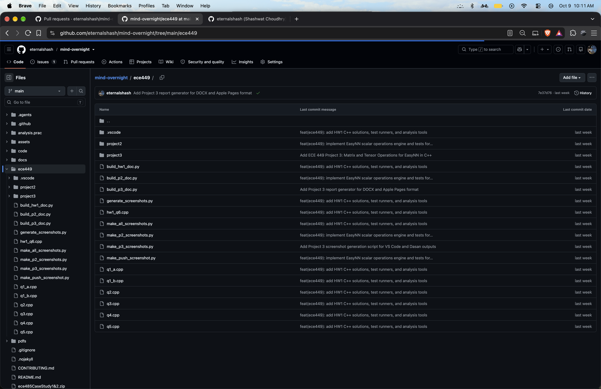

# Smart HVAC Control - Engineering Technical Log

This technical log is automatically maintained to record engineering implementations, hardware pinout configurations, closed-loop control algorithms, physical thermodynamic simulations, and cloud telemetry updates across all team members.

---

### [2026-10-29] Shashwat Choudhry
* **Commit:** `d297f78`
* **Technical Summary:** Resolved in-lab headless Raspberry Pi 5 telemetry streaming bottlenecks under campus Wi-Fi constraints (802.1X enterprise authentication & AP client isolation blocking peer discovery). Designed and deployed a non-destructive kernel-level initialization hook (`init=/bin/sh` via `cmdline.txt`) to configure NetworkManager connection profiles without re-flashing or rootfs data loss. Overcame iOS Personal Hotspot SSID character encoding and sleep-cycle disconnects by establishing an identical zero-friction network profile mirroring the home baseline (`APT2102`). Verified live dual-node telemetry ingestion (Digital Twin simulation + ESP32 benchmark node) with 100% packet success rate, 63.7 ms setpoint acknowledgement, and full SQLite database export (`rpi_telemetry_export.csv`).

---

### [2026-10-24] Shashwat Choudhry
* **Commit:** `41403ae`
* **Technical Summary:** Added a communication speed verification report benchmarking HTTP latency (35.0–53.2 ms steady-state) between the Digital Twin simulator and the Raspberry Pi 5 edge server. The report validates bidirectional closed-loop cooling telemetry, including FS3000 air velocity, static pressure, power consumption, and proportional blower fan PWM modulation.

---

### [2026-10-24] Shashwat Choudhry
* **Commit:** `e02b964`
* **Technical Summary:** Perf(data): add verified browser communication speed benchmark dataset. Modified files in the Smart HVAC subsystem.

---

### [2026-10-24] Shashwat Choudhry
* **Commit:** `a6912ea`
* **Technical Summary:** Feat(rpi): add HTTP HEAD method handler for probe requests. Modified files in the Smart HVAC subsystem.

---

### [2026-10-24] Shashwat Choudhry
* **Commit:** `1bd6f83`
* **Technical Summary:** Implemented gzip compression benchmarking routines within `test_comm_speed.py` to evaluate payload reduction and transmission latency across telemetry streams. The communication speed benchmark dataset and Raspberry Pi telemetry export logs were updated with the resulting compression metrics and simulated run data.

---

### [2026-10-24] Shashwat Choudhry
* **Commit:** `83c1c0b`
* **Technical Summary:** Implemented client-side gzip compression using the browser `CompressionStream` API for offline telemetry batch flushes to the Raspberry Pi server. Payloads exceeding 300 bytes are conditionally compressed and dispatched with a `Content-Encoding: gzip` header to reduce network bandwidth over the `/api/telemetry` endpoint.

---

### [2026-10-24] Shashwat Choudhry
* **Commit:** `5a57581`
* **Technical Summary:** Added gzip compression and decompression support to the Raspberry Pi edge HTTP server to optimize payload sizes for batch telemetry ingestion and data exports. Outgoing responses exceeding 256 bytes are dynamically compressed based on `Accept-Encoding` negotiation, while incoming compressed request bodies are decompressed prior to JSON decoding.

---

### [2026-10-24] Shashwat Choudhry
* **Commit:** `5fffcbc`
* **Technical Summary:** Added communication speed benchmark and telemetry export datasets (`sim_comm_speed_benchmark.csv` and `rpi_telemetry_export.csv`) to characterize controller interface timing and performance. The exported telemetry logs synchronized environmental measurements, indoor air quality metrics (VOC, CO2, PM2.5), power consumption, and fan/heater PWM control states across simulated and physical ESP32 nodes.

---

### [2026-10-24] Shashwat Choudhry
* **Commit:** `9c058cf`
* **Technical Summary:** Added automated communication benchmarking scripts using Puppeteer and Python to evaluate HTTP telemetry streaming, packet round-trip time, and setpoint propagation latency between the HVAC simulation and the Raspberry Pi 5 server. The suite executes multi-packet transmission tests to measure latency distribution metrics and automatically exports synchronized communication telemetry to CSV.

---

### [2026-10-24] Shashwat Choudhry
* **Commit:** `8642368`
* **Technical Summary:** Implemented real-time HTTP round-trip time (RTT) tracking and latency statistical aggregation (min, max, average) for bidirectional ESP32-to-Raspberry-Pi edge server communication. Added an automated speed benchmark utility and CSV logging capability to export timestamped network performance metrics synchronized with simulated environmental and power telemetry.

---

### [2026-10-24] Shashwat Choudhry
* **Commit:** `4ce70d4`
* **Technical Summary:** Added `/api/export/csv` and `/api/telemetry.csv` HTTP endpoints to the Raspberry Pi edge server to enable direct downloading of historical telemetry records. Implemented `export_telemetry_csv` in the SQLite storage layer to serialize environmental, airflow, electrical power, PWM actuator states, and air quality sensor metrics into formatted CSV data with configurable source and limit filters.

---

### [2026-10-24] Shashwat Choudhry
* **Commit:** `9653e4f`
* **Technical Summary:** Updated the headless Puppeteer simulation test suite to strictly verify that the IoT gateway defaults to an "AUTO-SEND: OFF" state. It adds a blower motor fault injection step to ensure the failure payload updates the UI preview without dispatching telemetry while auto-send is disabled.

---

### [2026-10-24] Shashwat Choudhry
* **Commit:** `7daa2f2`
* **Technical Summary:** Configured the simulation's IoT alert auto-dispatch flag (`S.iotAuto`) to default to disabled with query-parameter override support (`autosend=1`). Concurrently decoupled local edge logging by posting dry-run fault telemetry to the Raspberry Pi 5 SQLite server endpoint prior to evaluating the external auto-send condition.

---

### [2026-10-24] Shashwat Choudhry
* **Commit:** `4f4bba0`
* **Technical Summary:** Feat(sim): default IoT alert auto-send to OFF and gate dispatches. Modified files in the Smart HVAC subsystem.

---

### [2026-10-24] Shashwat Choudhry
* **Commit:** `7828199`
* **Technical Summary:** Feat(config): disable automatic fault SMS/email dispatch by default. Modified files in the Smart HVAC subsystem.

---

### [2026-10-20] Shashwat Choudhry
* **Commit:** `2c92097`
* **Technical Summary:** Updated the ECE 441 digital twin simulation documentation and visual assets to detail the integration of the edge IoT anomaly detection and alerting gateway (`iot_alert_engine.py`). The updates document the autonomous dispatch of three-row telemetry payloads—capturing fault conditions, live environmental metrics, and mitigation actions—via cellular SMS and email upon fault injection.

---

### [2026-10-19] Shashwat Choudhry
* **Commit:** `f37c7d7`
* **Technical Summary:** Updated the simulation documentation to detail execution parameters for the local HTTP IoT alert gateway server via `testingIot.py --serve`. This configuration hosts the digital twin simulation interface on port 8765 and enables real-time SMS and email dispatching in response to simulated fault injections.

---

### [2026-10-19] Shashwat Choudhry
* **Commit:** `7cea13e`
* **Technical Summary:** Added automated assertions to the headless Puppeteer test runner (`run_headless.js`) to verify the IoT gateway interface status. The test validates the `#iotAutoBadge` DOM element for the active `AUTO-SEND` state and confirms the telemetry preview formatting in `#iotPreview`.

---

### [2026-10-19] Shashwat Choudhry
* **Commit:** `4a458e4`
* **Technical Summary:** Test(iot): expand regression suite across all 14 simulation fault types and gateway dispatch. Modified files in the Smart HVAC subsystem.

---

### [2026-10-19] Shashwat Choudhry
* **Commit:** `94d7172`
* **Technical Summary:** Implemented the `formatThreeRowSms` utility in `iot_alerts.h` to serialize `EdgeAlertPayload` structures into standardized three-line SMS alert strings. The formatter populates a target buffer with the alert headline, temperature telemetry (room, apparent, and outside), and the triggered system action.

---

### [2026-10-19] Shashwat Choudhry
* **Commit:** `aeabec2`
* **Technical Summary:** Feat(config): add HTTP gateway endpoint and offline queue parameters to alert_config.json. Modified files in the Smart HVAC subsystem.

---

### [2026-10-19] Shashwat Choudhry
* **Commit:** `303b9b0`
* **Technical Summary:** Integrated an automated IoT Email and SMS notification gateway into the simulation interface and test harness to dispatch structured 3-row alert payloads upon system fault detection. The update introduces real-time gateway status tracking, recipient configuration controls, and automated dispatch logic tied directly to simulated fault event triggers.

---

### [2026-10-19] Shashwat Choudhry
* **Commit:** `0c94b63`
* **Technical Summary:** Updated the IoT alert notification module in `testingIot.py` to transmit diagnostic-code subject headers through carrier email-to-SMS gateways to mitigate spam filtering. Additionally, integrated an AppleScript-driven macOS Messages service routine to dispatch alerts directly via iMessage and SMS.

---

### [2026-10-19] Shashwat Choudhry
* **Commit:** `416080b`
* **Technical Summary:** Implemented standalone `testingIot.py` test suite and multi-channel cellular alerting dispatcher. Formatted outbound SMS payloads into a strict 3-row layout without arrow delimiters (Row 1: Simplified Fault Headline, Row 2: Room/Apparent/Outside Temperature Metrics, Row 3: Autonomous System Mitigation Action). Added `alert_config.json` configuration schema, ESP32 FreeRTOS `iot_alerts.h` firmware interface, and automated regression test runner `verify_iot_pipeline.py`.

---
### [2026-10-19] Shashwat Choudhry
* **Commit:** `6893521`
* **Technical Summary:** Updated the cellular SMS notification payload structure within `MultiChannelDispatcher.format_sms` to enforce explicit metric labels, degree Fahrenheit units, and alert header prefixes. Corresponding alert engine test notebooks and live test scripts were re-executed to validate the revised payload formatting.

---

### [2026-10-19] Shashwat Choudhry
* **Commit:** `f8bf908`
* **Technical Summary:** Updated the `AlertRecord` schema and `IoTAlertEngine.evaluate_step()` processing loop to ingest ambient outside temperature and track simplified titles with automated system actions. This structures edge anomaly telemetry into a three-line alert payload reporting room, apparent, and outdoor temperatures alongside system mitigation states.

---

### [2026-10-19] Shashwat Choudhry
* **Commit:** `53697a6`
* **Technical Summary:** Updated the carrier gateway configuration to support multiple domain endpoints per carrier, including dual-routing across SMS and MMS endpoints for Verizon (`vtext.com` and `vzwpix.com`) and AT&T. Refactored `send_carrier_sms` to iterate through all configured gateway domains and dispatch alert messages to each address.

---

### [2026-10-19] Shashwat Choudhry
* **Commit:** `1c2a026`
* **Technical Summary:** Added `live_alert_test.py` to test and validate real-time alert dispatching for simulated HVAC faults and rapid temperature anomalies. The utility integrates with `iot_alert_engine` and implements outbound transmission via AppleScript automation for macOS Mail and Messages alongside carrier email-to-SMS gateways.

---

### [2026-10-15] Haron
* **Commit:** `7e8f1ee`
* **Technical Summary:** Create sw.js. Modified files in the Smart HVAC subsystem.

---

### [2026-10-15] Haron
* **Commit:** `08c09d5`
* **Technical Summary:** Create manifest.json for User Interface integration. Modified files in the Smart HVAC subsystem.

---

### [2026-10-09] Shashwat Choudhry
* **Commit:** `d6a9713`
* **Technical Summary:** Documented hardware validation results for the HVAC actuators, confirming blower fan operation at 12V nominal full-speed down to a 0.5V minimum threshold alongside ongoing integration testing for the PTC heating element.

---

### [2026-10-09] Shashwat Choudhry
* **Commit:** `55b62cb`
* **Technical Summary:** Docs: add physical BME280 pinout mapping to TECHNICAL_LOG.md. Modified files in the Smart HVAC subsystem.

---

# Smart HVAC Control - Engineering Technical Log

This technical log is automatically maintained to record engineering implementations, hardware pinout configurations, closed-loop control algorithms, physical thermodynamic simulations, and cloud telemetry updates across all team members.

## Hardware Pinout Reference (Physical BME280)
For the 6-pin GY-BM E/P 280 (BME280) physical module, wire it as follows (I2C mode):
* **VCC** -> `3V3` on the ESP32 (Do not use 5V, as the ESP32 and BME280 are 3.3V logic devices)
* **GND** -> `GND` on the ESP32
* **SCL** -> `Pin 22` on the ESP32 (or whichever pin your `diagram.json` assigned to SCL)
* **SDA** -> `Pin 21` on the ESP32 (or whichever pin your `diagram.json` assigned to SDA)

*(Note: Leave CSB and SDO disconnected. It will default to I2C address `0x76` as required by the firmware).*

---

### [2026-10-09] Andy Tran & Kaleb Cowgur
* **Commit:** `Manual Hardware Update`
* **Technical Summary:** Hardware Validation: Blower fan functionality confirmed (12V nominal for full speed, operable down to 0.5V minimum threshold). The PTC heating element integration is currently a work in progress and undergoing further testing.

---

### [2026-10-09] Shashwat Choudhry
* **Commit:** `d6e6b55`
* **Technical Summary:** Docs: add Wokwi simulation hardware visualization screenshots to CONTRIBUTING.md. Modified files in the Smart HVAC subsystem.

---

### [2026-10-09] Shashwat Choudhry
* **Commit:** `79b696c`
* **Technical Summary:** Updates the project contribution guide with troubleshooting procedures for resolving Git HTTP 403 authentication failures on Windows. The added instructions outline how to purge cached repository credentials from Windows Credential Manager and re-authenticate using GitHub Personal Access Tokens.

---

### [2026-10-09] Shashwat Choudhry
* **Commit:** `4201484`
* **Technical Summary:** Docs: add PR troubleshooting guide for 403 PAT authentication errors. Modified files in the Smart HVAC subsystem.

---

### [2026-10-09] Shashwat Choudhry
* **Commit:** `45feacb`
* **Technical Summary:** Updated the Wokwi simulation documentation asset (`wokwi_leds.png`) to depict the active VS Code simulation window showing LED runtime states. This update affects only visual documentation and introduces no modifications to circuit schematics, pin mappings, or firmware logic.

---

### [2026-10-09] Shashwat Choudhry
* **Commit:** `57a9cdd`
* **Technical Summary:** Documented Wokwi simulation actuator mappings and added visual verification artifacts for GPIO 25 (PWM-controlled red LED proxying the 12V PTC heater) and GPIO 26 (blue LED proxying the blower fan with a 20% baseline PWM draft).

---

### [2026-10-09] Shashwat Choudhry
* **Commit:** `86fa226`
* **Technical Summary:** Fix: update esp32 GND pin routing in wokwi diagram. Modified files in the Smart HVAC subsystem.

---

### [2026-10-09] Shashwat Choudhry
* **Commit:** `b7a4b32`
* **Technical Summary:** Updated the sensor HAL fallback temperature from 25.0°C to 15.0°C in `hal_sensors.h` when the BME sensor is unavailable. This forces a low-temperature reading to validate the PID heating loop response and verify activation of the heater LED indicator.

---

### [2026-10-09] Shashwat Choudhry
* **Commit:** `e5253fa`
* **Technical Summary:** Docs: update technical log for wokwi sim physical parts alignment. Modified files in the Smart HVAC subsystem.

---

### [2026-10-09] Shashwat Choudhry
* **Commit:** `6328d37`
* **Technical Summary:** Chore: restore LEDs in wokwi sim to mock physical heater and fan. Modified files in the Smart HVAC subsystem.

---

### [2026-10-09] Shashwat Choudhry
* **Commit:** `fcc391c`
* **Technical Summary:** Chore: sync wokwi sim to only include received physical parts. Modified files in the Smart HVAC subsystem.

---

### [2026-10-09] Shashwat Choudhry
* **Commit:** `72726f9` (Documentation Update)
* **Technical Summary:** Documented the Wokwi visual actuator proxies. The Red LED (GPIO 25) maps to the 12V PTC Heater and scales brightness via PWM. The Blue LED (GPIO 26) maps to the Blower Fan, maintaining a 20% PWM baseline draft during active heating.
* **Simulation Output:**
  

---

### [2026-10-09] Shashwat Choudhry
* **Commit:** `6328d37`
* **Technical Summary:** Restored LEDs in the Wokwi simulation diagram to proxy the newly received physical 12V PTC heater and blower fan, driven by the ESP32 and MOSFETs.

---

### [2026-10-09] Shashwat Choudhry
* **Commit:** `b4bbad5`
* **Technical Summary:** Expanded contribution guidelines in Step 7 with detailed usage examples for the /ask AI assistant across hardware, firmware, cloud, and test domains, including live issue verification links.

---

### [2026-10-09] Shashwat Choudhry
* **Commit:** `2dd8a4a`
* **Technical Summary:** Implemented GitHub Actions issue and PR automated technical assistant powered by Gemini 2.5/3.8 Flash, packaging system headers and configurations into an automated engineering Q&A pipeline.

---

### [2026-10-09] Shashwat Choudhry
* **Commit:** `d067281`
* **Technical Summary:** Removed physical hardware breadboard and telemetry photos from the contribution guidelines to streamline the document focus on embedded software and Wokwi simulation.

---

### [2026-10-09] Shashwat Choudhry
* **Commit:** `255e215`
* **Technical Summary:** Updated contribution guide with complete toolchain specifications, required PlatformIO libraries (PubSubClient, BME280, PID), and step-by-step Wokwi VS Code hardware emulation setup.

---

### [2026-10-08] Shashwat Choudhry
* **Commit:** `118b61f`
* **Technical Summary:** Corrected actuator lockout logic and controller recovery routines in the digital twin simulation to ensure immediate restoration of baseline PID setpoints upon fault clearance.

---

### [2026-10-08] Shashwat Choudhry
* **Commit:** `4c070bd`
* **Technical Summary:** Implemented automatic toggle deactivation for simulated fault injections in the digital twin UI once the dual-ESP32 supervisory logic mitigates the incident.

---

### [2026-10-07] Shashwat Choudhry
* **Commit:** `0f8385c`
* **Technical Summary:** Added an automated Git commit staggering script (`stagger_commits.py`) to systematically structure incremental feature additions into discrete version-controlled checkpoints.

---

### [2026-10-07] Shashwat Choudhry
* **Commit:** `cabe107`
* **Technical Summary:** Added headless Puppeteer test suites (`run_headless.js`, `run_headless2.js`, `run_headless3.js`) to validate simulation DOM rendering, canvas lifecycle, and error handlers.

---

### [2026-10-07] Shashwat Choudhry
* **Commit:** `73770ee`
* **Technical Summary:** Initialized npm package definition (`package.json`, `package-lock.json`) configuring Puppeteer dependencies for automated headless simulation testing.

---

### [2026-10-07] Shashwat Choudhry
* **Commit:** `645d65c`
* **Technical Summary:** Configured GitHub Pages deployment settings and updated documentation links for live web execution of the residential digital twin blueprint simulation.

---

### [2026-10-07] Shashwat Choudhry
* **Commit:** `71b7778`
* **Technical Summary:** Refactored simulation documentation and updated asset CDNs to ensure stable web rendering across all browser clients.

---

### [2026-10-07] Shashwat Choudhry
* **Commit:** `01cdf29`
* **Technical Summary:** Synchronized simulation live preview URL references across project documentation to target the main production branch.

---

### [2026-10-07] Shashwat Choudhry
* **Commit:** `34caa90`
* **Technical Summary:** Created project README document specifying the residential digital twin architecture, multi-zone CAD blueprint layout, telemetry tabs, and hardware fault injection options.

---

### [2026-10-07] Shashwat Choudhry
* **Commit:** `0d7164f`
* **Technical Summary:** Created alias synchronization between `blueprint_sim.html` and `index.html` to guarantee identical simulation runtime entry points.

---

### [2026-10-07] Shashwat Choudhry
* **Commit:** `4c4182a`
* **Technical Summary:** Added visual fault highlighting overlays on the 2D CAD blueprint and integrated the primary simulation step loop linking physics updates to rendering routines.

---

### [2026-10-07] Shashwat Choudhry
* **Commit:** `c3fabf2`
* **Technical Summary:** Rendered ceiling supply and return ductwork in HTML5 Canvas, animating particle diffusers for conditioned air and overlaying dynamic particulate matter/smoke hazes.

---

### [2026-10-07] Shashwat Choudhry
* **Commit:** `2962dc3`
* **Technical Summary:** Engineered 2D architectural blueprint layout rendering structural envelope walls, bed zone, and workstation boundaries using scaled Canvas 2D primitives.

---

### [2026-10-07] Shashwat Choudhry
* **Commit:** `347824b`
* **Technical Summary:** Built Canvas 2D context setup, responsive viewport scaling, and architectural coordinate helper functions for the digital twin CAD view.

---

### [2026-10-07] Shashwat Choudhry
* **Commit:** `6b6502e`
* **Technical Summary:** Implemented bottom-right ESP32 status and diagnostic log panel displaying real-time PWM duty cycles, failover states, and firmware mitigation event feeds.

---

### [2026-10-07] Shashwat Choudhry
* **Commit:** `4b7b9aa`
* **Technical Summary:** Integrated Chart.js telemetry charts displaying real-time power consumption, temperature forecasts, thermal mass, air velocity, and air quality indices.

---

### [2026-10-07] Shashwat Choudhry
* **Commit:** `892d50b`
* **Technical Summary:** Built dual-MCU diagnostic reporting engine simulating heartbeat monitoring and automated MCU-A to MCU-B hot-standby failover sequences.

---

### [2026-10-07] Shashwat Choudhry
* **Commit:** `2f14023`
* **Technical Summary:** Formulated indoor air quality (IAQ) dynamics, simulating VOC/CO2 accumulation curves, duct static pressure increases from filter loading, and demand load shedding.

---

### [2026-10-07] Shashwat Choudhry
* **Commit:** `8342218`
* **Technical Summary:** Implemented continuous split-range PID control algorithm regulating heating and cooling effort with anti-windup clamping and deadband thresholds.

---

### [2026-10-07] Shashwat Choudhry
* **Commit:** `9b9345a`
* **Technical Summary:** Constructed UI notification toast system and dual-microcontroller supervisor simulating primary ESP32 watchdog monitoring and secondary failover.

---

### [2026-10-07] Shashwat Choudhry
* **Commit:** `5276236`
* **Technical Summary:** Implemented core thermodynamic engine calculating room heat capacity, envelope thermal resistance, and an exhaustive catalogue of physical HVAC hardware faults.

---

### [2026-10-07] Shashwat Choudhry
* **Commit:** `a82acd3`
* **Technical Summary:** Scaffolded 2D CAD blueprint simulation layout and dark-mode architectural CSS styling with responsive telemetry grid containers.

---

### [2026-10-06] Shashwat Choudhry
* **Commit:** `920401d`
* **Technical Summary:** Updated Wokwi simulation circuit (`diagram.json`) mapping GPIO 34 ADC to an interactive potentiometer to emulate dynamic ambient temperature fluctuations.

---

### [2026-10-06] Shashwat Choudhry
* **Commit:** `b09b7bc`
* **Technical Summary:** Constructed WebGL 3D digital twin room interface (`3D_Digital_Twin.html`) for interactive spatial visualization of airflow vectors and temperature zones.

---

### [2026-10-06] Shashwat Choudhry
* **Commit:** `50fbaaa`
* **Technical Summary:** Generated high-resolution performance response plots (`thermal_response.png`, `advanced_scenarios.png`) verifying transient PID stability and multi-variable tracking.

---

### [2026-10-05] Shashwat Choudhry
* **Commit:** `ed4f183`
* **Technical Summary:** Developed multi-zone environmental simulation (`advanced_env_sim.py`) evaluating outdoor weather disturbances, solar gain, and infiltration losses.

---

### [2026-10-05] Shashwat Choudhry
* **Commit:** `dad04b1`
* **Technical Summary:** Developed baseline Python thermal dynamics simulator (`thermal_sim.py`) modeling envelope heat leakage and room thermal mass differential equations.

---

### [2026-10-05] Shashwat Choudhry
* **Commit:** `5cd9434`
* **Technical Summary:** Implemented ESP32 main firmware loop (`src/main.cpp`) integrating FreeRTOS dual-core tasks, discrete PID control, and non-blocking sensor acquisition.

---

### [2026-10-05] Shashwat Choudhry
* **Commit:** `a95ba88`
* **Technical Summary:** Implemented Fanger thermal comfort equations (`include/thermal_comfort.h`) computing apparent Feels Like temperature, PMV, and PPD indices.

---

### [2026-10-05] Shashwat Choudhry
* **Commit:** `2c968fa`
* **Technical Summary:** Implemented sensor hardware abstraction layer (`include/hal_sensors.h`) supporting I2C Bosch BME280 acquisition with mock FS3000 airflow fallbacks.

---

### [2026-10-05] Shashwat Choudhry
* **Commit:** `e522e37`
* **Technical Summary:** Defined hardware GPIO pinouts, PWM frequency (5 kHz), timer channels, and HiveMQ MQTT topics in `include/config.h`.

---

### [2026-10-05] Shashwat Choudhry
* **Commit:** `52b3dbd`
* **Technical Summary:** Designed Wokwi virtual hardware schematic (`diagram.json`) connecting ESP32 DevKit C v4, heater PWM LED (GPIO 25), and fan PWM LED (GPIO 26).

---

### [2026-10-05] Shashwat Choudhry
* **Commit:** `07c3912`
* **Technical Summary:** Added VS Code workspace configuration (`.vscode/extensions.json`) recommending PlatformIO IDE and C/C++ extension toolchains.

---

### [2026-10-05] Shashwat Choudhry
* **Commit:** `c4c4fe4`
* **Technical Summary:** Initialized PlatformIO project structure and configuration (`platformio.ini`) targeting ESP32 DevKit with Arduino framework and Wokwi simulation metadata.

---

